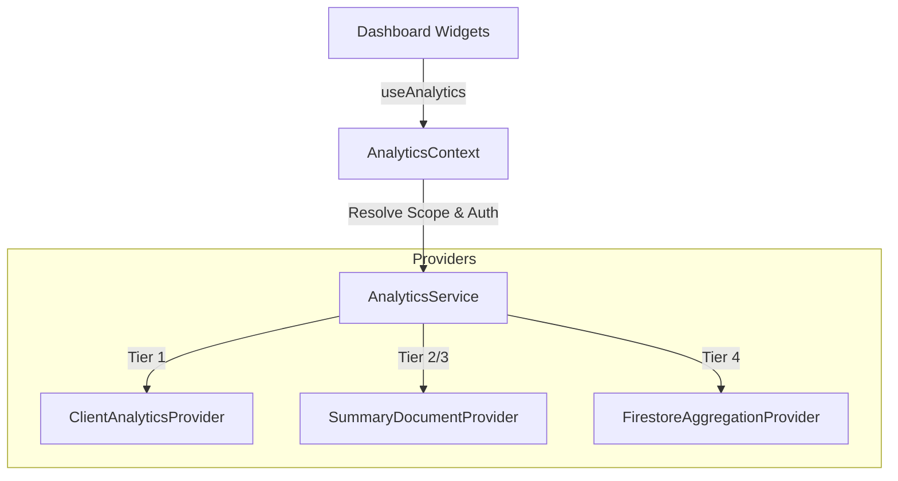

# Analytics Architecture Specification

This specification documents the decoupling architecture designed to isolate widgets from transactional Firestore engines and handle pre-aggregated states.

## Key Attributes

1. **Isolation**: Widgets consume pre-aggregated payloads without performing reductions or DB requests directly.
2. **Deterministic Routing**: Provider layers are checked sequentially: `Client` -> `Summary` -> `Aggregation`.
3. **Decoupled Extensions**: Providers can be updated (e.g. connecting Summary to BigQuery) without affecting React widgets.
