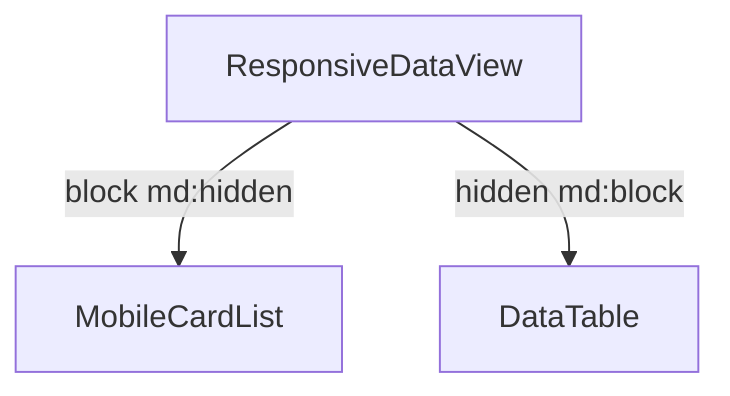

# Mobile Responsive Architecture

This document describes the mobile-responsive rendering architecture in the Golden Acres CRM.

---

## 1. CSS-First Layout Switcher

To prevent hydration issues, avoid resize event listeners, and ensure instant rendering, the CRM employs a CSS-first layout strategy.



Both list components are mounted in the React render tree, and Tailwind visibility classes toggle their presentation seamlessly.

---

## 2. Safe Area Enveloping

Safe areas (for notches and Home gesture indicators) are handled strictly at the boundary of shared overlay components:

```
+------------------------------------------+
|  Modal Header                            |
|  - Padding Top: pt-[calc(1rem+env(S-A))] |
+------------------------------------------+
|  Scrollable Dialog Body                  |
|                                          |
+------------------------------------------+
|  Sticky Dialog Footer                    |
|  - Padding Bottom: pb-[calc(1rem+env)]   |
+------------------------------------------+
```

Features and pages do not require custom offsets, keeping the markup clean and responsive.
