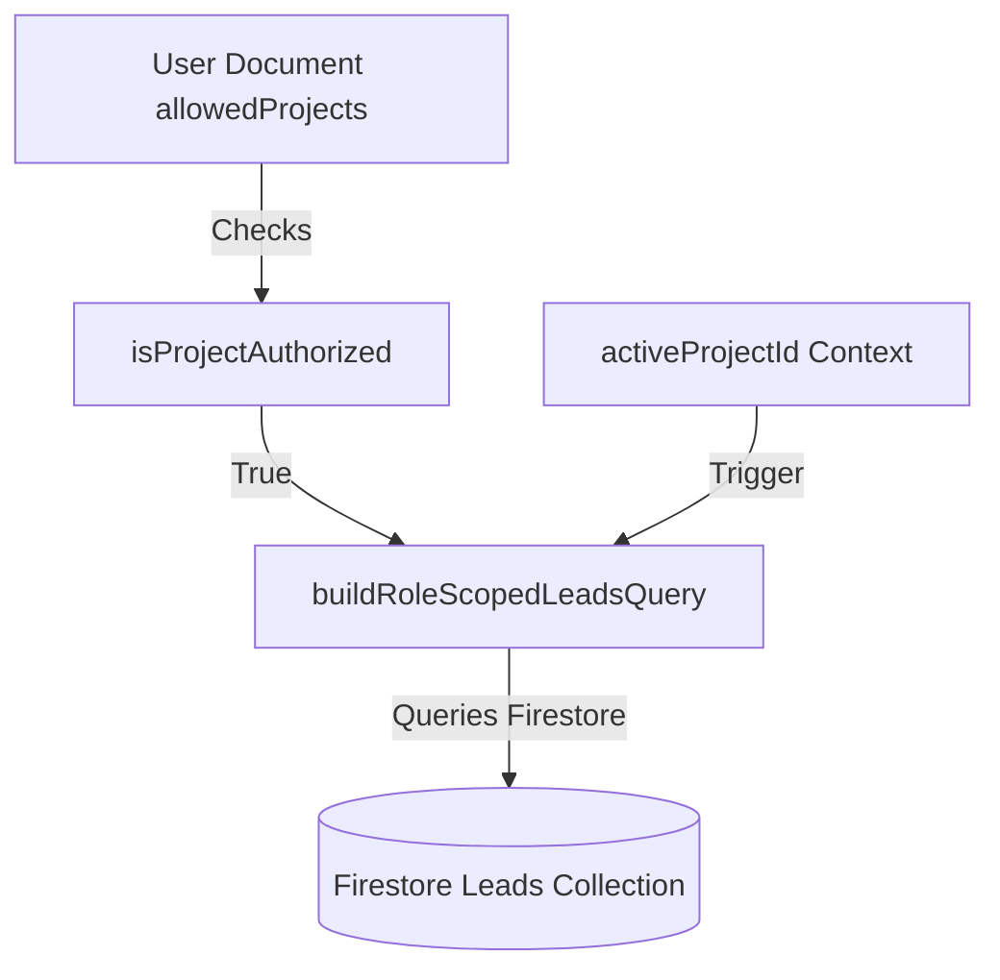

# Project Scope Architecture (Wave 8 Phase 2A)

This document outlines the architecture for Project Scoping, describing how data partitions and user allowed scopes are managed.

## Scoping Models

1. **User Membership Boundary**:
   Each user document can have an optional `allowedProjects?: string[]` field.
   - If `allowedProjects` is present and contains project IDs, the user is restricted to viewing and interacting with leads in those projects.
   - If `allowedProjects` is missing, undefined, or empty, the system defaults to "legacy/single-project mode" and grants full access to all projects.

2. **Tenant Scoping Prep**:
   The `User` type has been prepared with an optional `organizationId?: string` field to support future multi-tenant deployments without database migrations.

3. **Active Project Selection**:
   The `useProjectScope()` hook exposes `activeProjectId` and `setActiveProjectId` allowing users to focus their workspace:
   - When `activeProjectId` is set, leads are queried from Firestore with a `where("projectId", "==", activeProjectId)` filter.
   - Unsubscribing and subscribing is handled reactively by `DatabaseProvider` to minimize cost and performance overhead.

---

## Data Boundary Implementation

