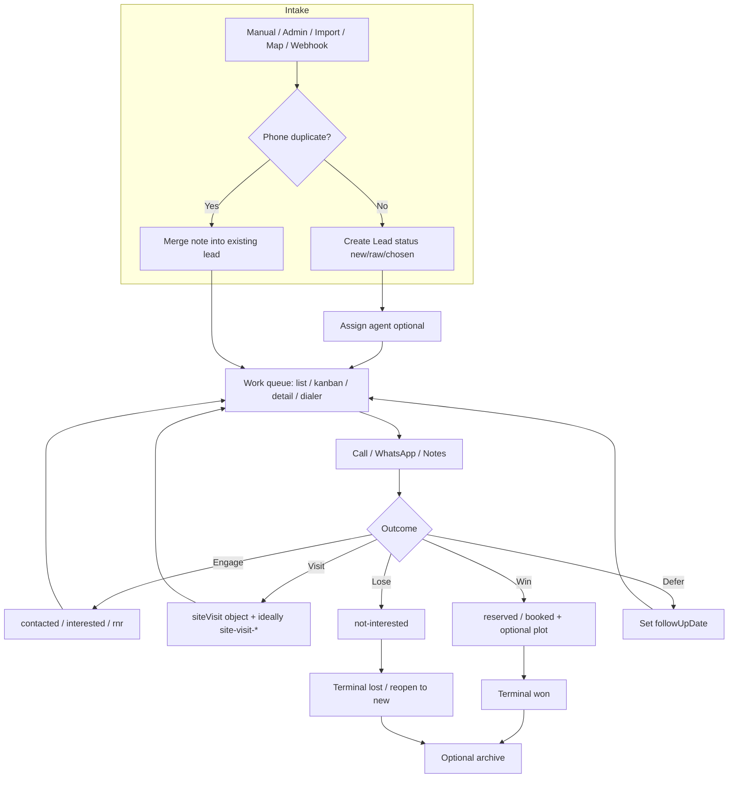
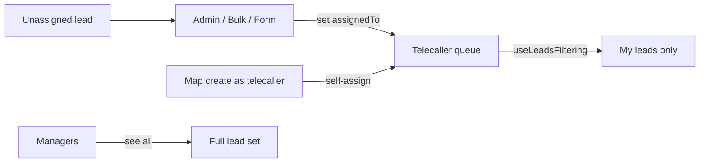
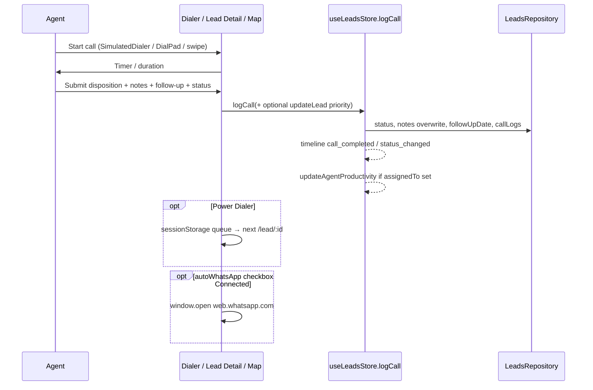
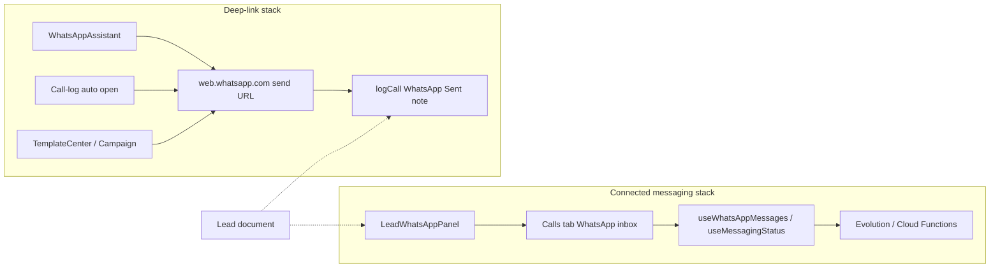
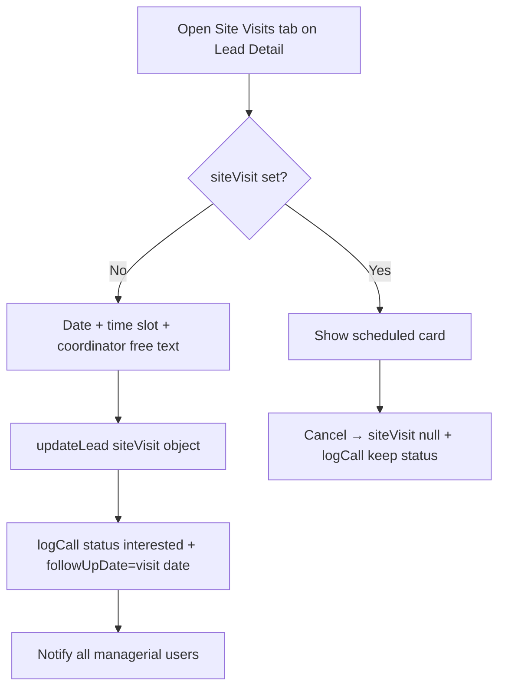
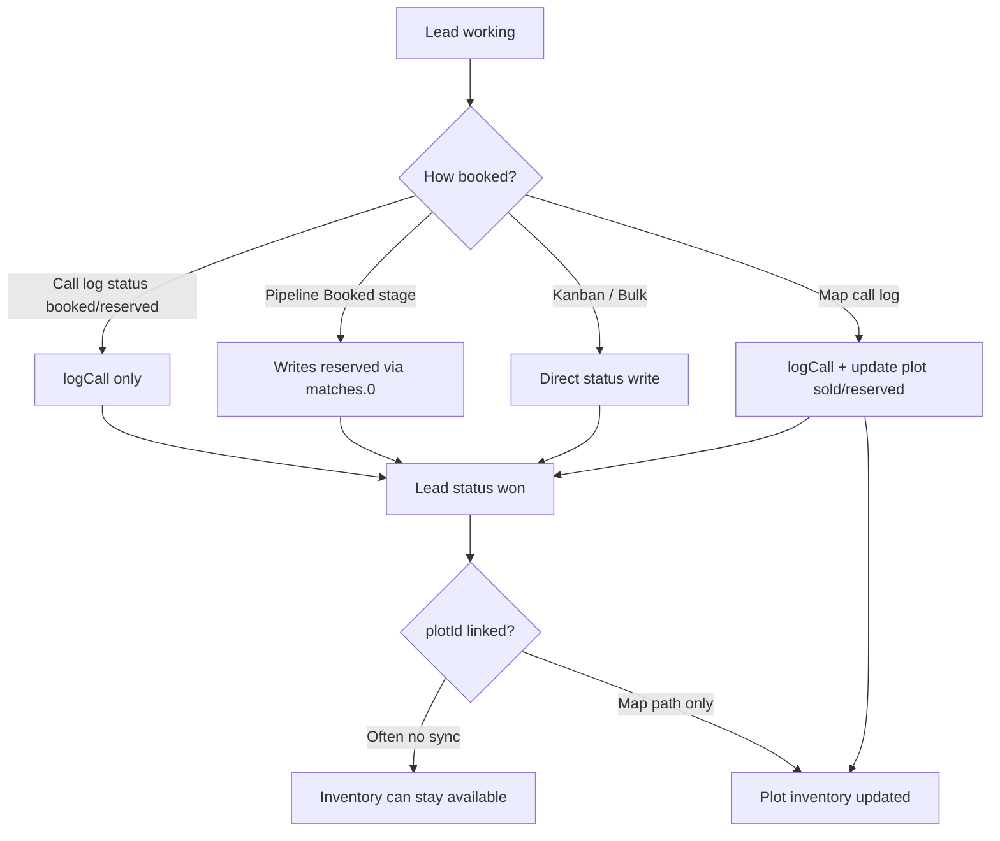
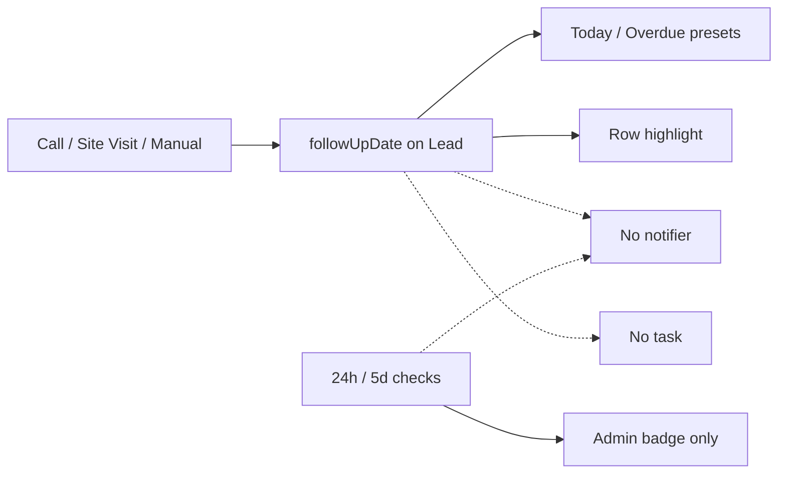

# Wave 6 Agent 1 — CRM Workflow Audit

**Status:** Audit complete — findings only (no application code changes)  
**App:** `telecaller-app/`  
**Scope:** Lead lifecycle, assignment, status transitions, calling, WhatsApp, site visit, booking, lost, follow-up  
**Constraint:** Read code only; deliver workflow diagrams, bottlenecks, duplicates, missing automations, UX friction, recommendations  
**Primary stores / types:** `telecaller-app/src/features/leads/hooks/useLeadsStore.ts`, `telecaller-app/src/features/leads/types/index.ts`, `telecaller-app/src/shared/services/firebase/repositories.ts`

---

## Executive Summary

The Golden Acres CRM sales path is **manual and UI-driven**: agents create/update leads, dial, log outcomes, schedule visits, send WhatsApp, and mark booked/lost. Persistence is centered on the Lead document (`status`, `assignedTo`, `followUpDate`/`followUpOn`, embedded `callLogs`, optional `siteVisit`, `plotId`/`projectId`).

The system works as a **human-operated CRM**, not an automated workflow engine. The highest-impact gaps are:

1. **Fragmented status taxonomy** — many UIs expose different subsets/mappings of the same string statuses.
2. **Site visit does not advance pipeline stage** — scheduler forces `interested`, not `site-visit-confirmed`.
3. **Booking is split** — lead status can become `booked`/`reserved` without updating plot inventory (except the Project Map call-log path).
4. **Dual WhatsApp stacks** — deep-link template assistant vs Evolution-connected inbox, with little shared disposition logic.
5. **Follow-up / SLA are display-only** — overdue presets and badges exist; no reminder notifications or task generation.
6. **Double-write status/history pattern** — many flows call `updateLead` then `logCall`, and `logCall` overwrites top-level `notes`.

---

## Canonical Status Vocabulary

**Declared filter / admin vocabulary** (`telecaller-app/src/features/leads/config/leadListFilterConfig.ts` → `LEAD_STATUS_OPTIONS`):

| Value | Label |
| --- | --- |
| `raw` | Raw |
| `new` | New |
| `not-attempted` | Not Attempted |
| `contacted` | Contacted |
| `interested` | Interested |
| `rnr` | RNR |
| `site-visit-confirmed` | Site Visit Confirmed |
| `site-visit-completed` | Site Visit Completed |
| `booked` | Booked |
| `reserved` | Reserved |
| `not-interested` | Not Interested |

**Also referenced in code but not in `LEAD_STATUS_OPTIONS`:** `re-engaged` (mapped inside `SegmentedStageTracker`).

**Lead model** (`telecaller-app/src/features/leads/types/index.ts`): `status: string` — no enum / transition guard at the type or repository layer.

---

## 1. Lead Lifecycle (Create → Work → Close)

### Entry points

| Path | File(s) | Default status / assignment |
| --- | --- | --- |
| Agent submit form | `LeadSubmissionForm.tsx`, `LeadsTab.tsx` | User-chosen status (subset); assignment depends on form/host |
| Admin create/edit | `AdminLeadModal.tsx`, `useAdminLeads.ts` | Explicit `assignedTo` + status |
| Bulk CSV import | `BulkLeadImportModal.tsx`, `useLeadsStore.bulkAddLeads` | Mapped status or `new`; phone dedupe merges |
| Project Map link / create | `ProjectMap.tsx`, `LinkLeadModal.tsx` | `new`; telecaller auto-assigns self |
| Dial pad / ad-hoc | `DialPadDrawer.tsx` | Can create lean `new` leads |
| Webhooks (integrations) | Admin integrations copy + notes heuristics in `AdminDashboard.tsx` | External ingest; treated as system notes |

### Dedup / merge

- Phone normalize + in-memory duplicate merge on create: `useLeadsStore.addLead` / `bulkAddLeads`.
- Admin merge UI: `MergeSettingsTab.tsx` + `useLeadsStore.mergeLeads`.
- Archive / restore: `archiveLeads` → Lead Bin (`LeadBinWorkspace.tsx`).

### Lifecycle diagram



---

## 2. Assignment Workflow

### How assignment works today

| Mechanism | File | Behavior |
| --- | --- | --- |
| Admin form create/edit | `AdminLeadModal.tsx`, `useAdminLeads.handleSaveLead` | Sets `assignedTo` + denormalized `assignedToName` |
| Inline admin reassign | `AdminLeadsTab.tsx` + `useAdminLeads.handleReassign` | Dropdown per row; audit log |
| Bulk reassign | `BulkActionsPanel.tsx` | `bulkUpdateLeads` with assignee |
| Lead Bin restore | `LeadBinWorkspace.tsx` | Restore + mandatory reassign |
| Map create (telecaller) | `ProjectMap.tsx` `handleLinkLeadSubmit` | Auto-assigns current telecaller |
| Visibility gate | `useLeadsFiltering.ts` | Non-managerial users only see `assignedTo === user.id` |

### Timeline side effect

`useLeadsStore.updateLead` emits `lead_assigned` / `lead_reassigned` timeline events when `assignedTo` changes.

### Gaps

- **No auto-distribution** (round-robin, load-balanced, source-based routing).
- **No claim / unclaim** workflow for unassigned inbox (`raw` / unassigned leads sit until admin assigns).
- **Denormalized name drift risk** if username changes (`assignedToName` stored separately).
- **No notification to assignee** on assign/reassign (unlike site-visit → admin notify).



---

## 3. Status Transitions

### Transition surfaces (duplicates)

| Surface | File | What it writes |
| --- | --- | --- |
| Detail pipeline | `LeadPipelineTracker.tsx` + `LeadDetailsPage.tsx` | Stage click → `matches[0]` then `updateLead` + `logCall` |
| Kanban DnD | `LeadsTab.handleKanbanDrop` | `updateLead` + `logCall` |
| Admin stage chip | `SegmentedStageTracker` in `AdminLeadsTab.tsx` | Coarse 5-stage statuses + `logCall` |
| Call log (detail) | `CallLoggingForm.tsx` + `LeadDetailsPage.handleCallLogSubmit` | `logCall` status from form (partial list) |
| Call log (modal) | `CallLogModal.tsx` | Connected → force `contacted` if was `new` |
| Map call log | `MapCallLogModal.tsx` / `ProjectMap.handleMapCallLogSubmit` | Status + optional plot status sync |
| Site visit schedule | `SiteVisitScheduler.tsx` | Forces status **`interested`** |
| Bulk status | `BulkActionsPanel.tsx` | Direct `bulkUpdateLeads` (no call log) |
| Lost toggle | `LeadDetailsPage` pipeline Ban | `not-interested` ↔ reopen as **`new`** |

### Stage model mismatch (critical)

```mermaid
flowchart TB
  subgraph canonical [LEAD_STATUS_OPTIONS - 11 values]
    raw --> new --> contacted --> interested
    interested --> svc[site-visit-confirmed]
    svc --> svd[site-visit-completed]
    svd --> booked
    interested --> reserved
    reserved --> booked
    new --> rnr
    any --> lost[not-interested]
  end

  subgraph pipelineUI [LEAD_PIPELINE_STAGES - 6 buckets]
    P1[Inbox=raw]
    P2[New=new|not-attempted]
    P3[Contacted]
    P4[Interested]
    P5[Site Visit=confirmed|completed]
    P6[Booked=reserved|booked]
  end

  subgraph adminChip [SegmentedStageTracker - 5 buckets]
    S1[Inbox→writes new]
    S2[Engaged→writes interested]
    S3[Visit→writes site-visit-confirmed]
    S4[Booked→writes booked]
    S5[Lost→writes not-interested]
  end

  subgraph callForm [CallLoggingForm options]
    C1[new / contacted / interested / reserved / booked / not-interested]
    C2[Missing: raw, rnr, site-visit-*, not-attempted]
  end
```

**Friction:** Clicking “Site Visit” on the detail pipeline always writes `site-visit-confirmed` (`matches[0]`), never `site-visit-completed`. Clicking “Booked” always writes `reserved`, never `booked`.

### Persistence semantics

`LeadsRepository.logCall` (`repositories.ts`) always:

- sets `status`
- sets `followUpDate`
- **overwrites `notes` with the call note**
- `arrayUnion`s into `callLogs`

So any flow that `updateLead({ status })` then `logCall(...)` performs **two status writes**; the second wins. Non-call actions (pipeline, site visit, discounts) still go through `logCall`, bloating call history with non-call events.

---

## 4. Calling Workflow

### Paths



| Component | File | Role |
| --- | --- | --- |
| Detail dialer | `LeadDetailsPage.tsx`, `SimulatedDialer` | In-page simulated call + duration stamp into notes |
| Call outcome form | `CallLoggingForm.tsx` | Disposition, priority, status, follow-up |
| Shell modal | `CallLogModal.tsx` | Post-dial from app shell / dial pad |
| Map modal | `MapCallLogModal.tsx` | Map-context logging |
| Power dialer | `LeadsTab` + `LeadDetailsPage` sessionStorage | Queue progression after save |
| Mobile swipe | `LeadsTab.handleTouchEnd` | Swipe right → call |

### Bottlenecks / bugs

1. **Disposition ≠ status** on detail form — agent must set both; easy to log “Connected” while leaving status `new`.
2. **Dead disposition branches** — `LeadDetailsPage` treats `"Interested" | "Site Visit Scheduled" | "Booked"` as picked, but `CallLoggingForm` disposition options do not include those values.
3. **Inconsistent auto-status** — `CallLogModal` auto-promotes `new`→`contacted` on Connected; detail form does not.
4. **RNR status vs disposition** — disposition “Ringing/Unanswered” does not set status `rnr`.
5. **Productivity attribution** — telemetry uses `prevLead.assignedTo`, not the logging agent’s user id (`useLeadsStore.logCall`).

---

## 5. WhatsApp Workflow

### Two parallel stacks



| Stack | Files | Behavior |
| --- | --- | --- |
| Template assistant | `WhatsAppAssistant.tsx`, `whatsappTemplates` | Opens WA Web; logs optimistic “sent” via `logCall`; **does not change status** |
| Lead summary | `LeadWhatsAppPanel.tsx` | Shows last message / unread; links to `/calls?tab=whatsapp&lead=` |
| Inbox / Evolution | `features/messaging/*`, `WhatsAppInboxView.tsx`, `EvolutionIntegrationsPanel.tsx` | Connected provider path |
| Campaigns | `CampaignBroadcastModal.tsx` | Bulk template-ish outreach + `logCall` per lead |
| Post-call auto | `LeadDetailsPage` + `#autoWhatsAppCheck` | DOM checkbox; only on Connected |

### Gaps

- Deep-link “sent” is **not delivery-verified**; connected inbox is the real channel of record.
- No automatic status move on WhatsApp reply / unread.
- No bridge: sending via assistant does not create a messaging-timeline message (and vice versa may not append `callLogs`).
- Auto-send uses brittle `document.getElementById("autoWhatsAppCheck")`.

---

## 6. Site Visit Workflow

### Current flow (`SiteVisitScheduler.tsx`)



### Critical workflow defect

Scheduling a site visit sets lead status to **`interested`**, not `site-visit-confirmed`. Pipeline / filters for site-visit stages therefore **do not light up** from the scheduler itself. Agents must separately click pipeline/kanban/bulk to set the correct status.

### Other gaps

- No UI to mark **`site-visit-completed`** (or no-show) from the scheduler.
- Coordinator is free text, not a user/role picker.
- No reminder to agent/coordinator on visit day.
- Cancel does not notify admins.
- `SiteVisit.status` field exists on the type but is unused by the scheduler.

---

## 7. Booking Workflow

### Paths to “won”



| Concern | Evidence |
| --- | --- |
| Lead↔plot link without sale | `LinkLeadModal.tsx` / map link sets `projectId`+`plotId`, status stays `new` |
| Inventory sync only on map call log | `ProjectMap.handleMapCallLogSubmit` maps `booked`→plot `sold`, `reserved`→`reserved` |
| Detail booking skips plots | `LeadDetailsPage` / `CallLoggingForm` can set `booked` with no plot update |
| Pipeline “Booked” writes `reserved` | `LeadPipelineTracker` `matches[0]` for booked bucket |
| Discount gate | `DiscountManager.tsx` / `PendingDiscountsApprovals.tsx` — commercial side-path, not required to book |
| Analytics | `AdminDashboard.tsx` counts `booked` / `reserved` for conversion |

### Gaps

- No single **Booking action** that atomically: set lead status, lock plot, notify admin, create receipt task.
- Risk of **double-booking** plots if agents only change lead status.
- `reserved` vs `booked` semantics unclear to agents across UIs.

---

## 8. Lost Lead Workflow

| Action | File | Result |
| --- | --- | --- |
| Pipeline Ban toggle | `LeadDetailsPage` + `LeadPipelineTracker` | `not-interested`; reopen → **`new`** |
| Call log status | `CallLoggingForm` | Manual `not-interested` |
| Admin/bulk | `BulkActionsPanel`, admin stage chip | Direct status |
| Archive | `archiveLeads` / Lead Bin | Soft-delete collection move — separate from lost |

### Gaps

- **No lost reason** field (budget / location / competitor / invalid).
- Reopen always resets to `new`, discarding prior stage (`interested`, site-visit, etc.).
- Lost leads remain in active collection until archived; no auto-archive SLA.
- `not-interested` is terminal for idle/SLA helpers, but still appears in agent queues unless filtered.

---

## 9. Follow-up Workflow

### What exists

| Capability | File | Notes |
| --- | --- | --- |
| Set date on call log | `CallLoggingForm`, `CallLogModal`, map log | Written via `logCall` → `followUpDate` |
| Dual fields | `Lead.followUpDate` + legacy `followUpOn` | Readers OR both; writers often only `followUpDate` |
| Queue presets | `LEAD_LIST_PRESETS` today / overdue | Filter-only |
| Row urgency | `LeadsTableRow.tsx` | Overdue / today styling |
| Idle badge | `useLeadsFiltering.isLeadIdle` | 3 days no `updatedAt` change |
| SLA / Stuck (admin) | `useAdminLeads.checkSlaBreach` / `checkStatusEscalation` | 24h no agent call; 5d no update — **badges only** |
| Timeline | `useLeadsStore.updateLead` / `logCall` | `followup_created` / `followup_completed` |

### Missing automations

- No push/in-app **reminder** when follow-up is due or overdue.
- No task records generated from follow-up dates (`tasksRef` exists in repositories but is not wired into this lead follow-up path).
- No escalation notification when SLA/Stuck thresholds breach.
- Site visit sets follow-up to visit date, but there is no visit-day workflow beyond that date field.
- Clearing follow-up is easy to miss; empty `followUpDate` on `logCall` may wipe a prior date unintentionally.



---

## Bottlenecks (Ranked)

| Rank | Bottleneck | Impact | Where |
| --- | --- | --- | --- |
| 1 | Status vocabulary fragmented across UIs | Wrong stage reporting, incomplete filters | Pipeline / Segmented / Call form / Submission |
| 2 | Site visit scheduler writes `interested` | Site-visit KPIs & queues undercount | `SiteVisitScheduler.tsx` |
| 3 | Booking without plot lock (except map path) | Inventory inconsistency | Detail call log vs `ProjectMap` |
| 4 | Manual assignment only | Unassigned / uneven load | Admin + bulk only |
| 5 | `logCall` used as generic event bus + overwrites `notes` | Noisy history; lost top-level notes | `LeadsRepository.logCall` |
| 6 | Dual WhatsApp systems | Split truth for conversations | Assistant vs messaging inbox |
| 7 | Follow-up/SLA display-only | Missed callbacks | Presets/badges, no notify |
| 8 | Disposition/status decoupled on primary call form | Stale pipeline after “successful” calls | `CallLoggingForm` |

---

## Duplicate Processes

1. **Status change × many:** pipeline, kanban, admin chip, call forms, bulk, site visit side-effect — no single transition service.
2. **Call logging × three UIs:** `CallLoggingForm`, `CallLogModal`, `MapCallLogModal` — different disposition lists and auto-status rules.
3. **WhatsApp send × multiple:** Assistant, post-call auto-open, Template Center, Campaign Broadcast.
4. **Idle / SLA / Stuck / Overdue:** four similar “needs attention” concepts with different thresholds (3d / 5d / 24h / follow-up date).
5. **Follow-up field aliases:** `followUpDate` vs `followUpOn`.
6. **Stage aggregation × two:** `LEAD_PIPELINE_STAGES` vs `SegmentedStageTracker` stages — different write targets and labels.
7. **History:** embedded `callLogs` plus messaging timeline events — overlapping narratives for Agent 2.

---

## Missing Automations

| Opportunity | Trigger | Suggested action | Dependency |
| --- | --- | --- | --- |
| First-touch SLA | Lead created unassigned or untouched 24h | Notify manager + optional auto-assign | Assignment rules (Agent 0/3) |
| Follow-up due | `followUpDate === today` / overdue | In-app + optional WA/task | Notification service |
| Site visit confirm | Scheduler save | Set `site-visit-confirmed`; remind D-1 / D-0 | Status canonicalization |
| Site visit outcome | Visit day + agent input | `completed` / no-show → next status | Scheduler upgrade |
| RNR cadence | Disposition unanswered N times | Set `rnr`, schedule next attempt | Call form mapping |
| Booking atomicity | Status → booked/reserved | Lock plot, notify admin | Plot service transaction |
| WhatsApp reply | Inbound message | Bump priority / suggest status / notify assignee | Messaging webhooks |
| Lost reason + cool-off | Mark not-interested | Capture reason; optional auto-archive after N days | Lead fields |
| Assignment notify | `assignedTo` change | Notify agent | Notifications store |
| Stale escalation | 5d Stuck | Create task / reassign pool | Already detected in admin UI only |

---

## UX Friction Report

| Friction | User effect | Source |
| --- | --- | --- |
| Must set status separately from disposition | Extra cognitive load; inconsistent data | `CallLoggingForm` |
| Site visit “success” leaves stage at Interested | Agents think visit is tracked; reports disagree | `SiteVisitScheduler` |
| Pipeline Booked → `reserved` | Confusion between reserved and booked | `LeadPipelineTracker` |
| Reopen lost → always `new` | Loses context | `LeadDetailsPage` |
| WhatsApp “Send & Log” vs “Open Conversation” | Unclear which is official | Assistant vs Panel |
| Auto WhatsApp via hidden checkbox id | Easy to miss / brittle | `LeadDetailsPage` |
| Call log overwrites lead `notes` | Profile notes disappear | `LeadsRepository.logCall` |
| Power dialer queue in `sessionStorage` | Fragile across tabs/reloads | `LeadDetailsPage` |
| Telecaller cannot see unassigned leads | Dependency on admin assignment speed | `useLeadsFiltering` |
| Incomplete status lists on create/call forms | Cannot select site-visit / rnr without other UI | `LeadSubmissionForm`, `CallLoggingForm` |

---

## Recommendations (for Wave 6 planning — do not implement in Phase 1)

### P0 — Canonical workflow contract (Architecture Owner)

1. **Single status enum + allowed transitions** (shared types / transition helper owned by Agent 0).
2. **One write path for status changes** that records a typed timeline event (stop overloading `logCall` for non-calls).
3. **Stop overwriting `notes` in `logCall`**; keep conversation text in `callLogs` / timeline only.
4. **Normalize `followUpOn` → `followUpDate`** (read alias OK; write one field).

### P1 — Fix broken stage semantics (feature + shared)

5. Site visit schedule → **`site-visit-confirmed`** (+ optional completed/no-show actions).
6. Pipeline stage writes should target **explicit** status (or ask reserved vs booked; confirmed vs completed).
7. Call disposition → **suggested status mapping** (Connected→contacted, RNR→rnr, etc.) with override.
8. Booking action → **optional atomic plot update** when `plotId` present (unify map + detail).

### P2 — Automation candidates (Agent 3)

9. Follow-up due/overdue notifications.
10. Assignment notifications + basic auto-assign policy for `raw`/unassigned.
11. SLA breach notifications (reuse existing 24h / 5d detectors).

### P3 — Channel unification (Agent 2/4 adjacent)

12. Prefer connected WhatsApp inbox as system of record; treat deep links as fallback and mark logs as `wa_deeplink_opened` not `sent`.
13. Lost-reason capture + smarter reopen (restore previous status).

---

## File Index (cited)

| Area | Paths |
| --- | --- |
| Types | `telecaller-app/src/features/leads/types/index.ts` |
| Store / writes | `telecaller-app/src/features/leads/hooks/useLeadsStore.ts` |
| Firestore repo | `telecaller-app/src/shared/services/firebase/repositories.ts` |
| Status options / presets | `telecaller-app/src/features/leads/config/leadListFilterConfig.ts` |
| Filtering / idle | `telecaller-app/src/features/leads/hooks/useLeadsFiltering.ts` |
| Detail UX | `telecaller-app/src/features/leads/pages/LeadDetailsPage.tsx` |
| Pipeline | `telecaller-app/src/features/leads/components/LeadPipelineTracker.tsx` |
| Admin chip | `telecaller-app/src/shared/components/SegmentedStageTracker.tsx` |
| Call forms | `CallLoggingForm.tsx`, `CallLogModal.tsx`, `MapCallLogModal.tsx` |
| Site visit | `SiteVisitScheduler.tsx` |
| WhatsApp | `WhatsAppAssistant.tsx`, `LeadWhatsAppPanel.tsx`, `features/messaging/*` |
| Assignment / admin | `useAdminLeads.ts`, `AdminLeadsTab.tsx`, `BulkActionsPanel.tsx` |
| Booking / plots | `ProjectMap.tsx`, `LinkLeadModal.tsx` |
| Lists / kanban | `LeadsTab.tsx`, `LeadsTableRow.tsx`, `LeadsKanbanBoard.tsx` |
| Lost / archive | `LeadPipelineTracker`, `LeadBinWorkspace.tsx` |

---

## Handoff Notes

- **Agent 2 (Timeline):** Expect duplicate events from `updateLead` + `logCall` pairs; non-call notes inside `callLogs`; WhatsApp deep-link logs vs messaging events.
- **Agent 3 (Automation):** Highest ROI = follow-up reminders, first-touch SLA notify, site-visit status fix, assignment notify — detectors partially exist as badges only.
- **Agent 4 (Intelligence):** Rich signals already present (`priority`, overdue, idle, SLA, RNR, siteVisit, discountRequest) but not scored centrally.
- **Agent 0:** Lock shared transition API / event types before feature agents implement P0–P1.
- **Agent 6:** This document is the workflow baseline for the executive Wave 6 audit rollup.

---

## Done Criteria

- [x] Lead lifecycle documented with diagram  
- [x] Assignment documented  
- [x] Status transitions + mismatches documented  
- [x] Calling / WhatsApp / Site visit / Booking / Lost / Follow-up audited  
- [x] Bottlenecks, duplicates, missing automations, UX friction, recommendations with file citations  
- [x] No application code changes  

**Deliverable path:** `directives/wave6-agent1-workflow-audit.md`
