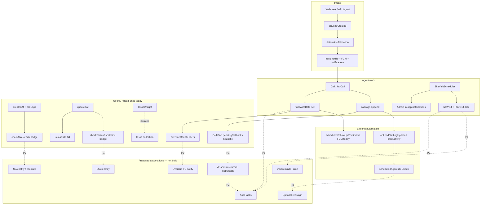

# Wave 6 Phase 1 — Agent 3: Workflow Automation Audit

**Status:** Audit complete — findings only (no application code / handler / engine changes)  
**App:** `telecaller-app/`  
**Scope:** Follow-up reminders, missed calls, booking reminders, assignment, SLA, escalations, notifications, task generation  
**Constraint:** Read-only. Deliver automation opportunities, priority ranking, dependency graph. **Do NOT** build an automation engine or change handlers.  
**Governed by:** `directives/wave6-execution-plan.md` (Phase 1 audits authorized; Phase 2 implementation requires separate auth)  
**Cross-refs:** Agent 1 workflow audit (`wave6-agent1-workflow-audit.md`), Agent 4 intelligence (`wave6-agent4-intelligence-audit.md` — health/stale consumers), Agent 2 timeline (`wave6-agent2-timeline-audit.md`)

---

## Executive Summary

There is **no general-purpose workflow / rule / automation engine**. Automation today is a thin set of **discrete Cloud Functions** (Firestore triggers + three crons) plus **client-side badges and queues**. Most CRM “attention” workflows still require an agent or admin to notice and act.

| Maturity | Areas |
| --- | --- |
| **Automated** | Inbound round-robin assignment + FCM on create; same-day follow-up FCM; agent idle flag + audit |
| **Partial** | Overdue / follow-up UI queues; missed-call heuristic queue; SLA / Stuck badges; ad-hoc in-app notifications |
| **Manual** | Reassignment; site-visit day-of reminders; task creation; escalation actions; most WhatsApp confirmations |

**Highest-ROI gaps (do not implement in Phase 1):** overdue + first-touch SLA notify jobs, missed-call → structured event + notify/task, site-visit reminder job, stuck-lead escalation notify. Prefer extending existing crons/`sendFcm` under Architecture Owner ownership — **not** inventing a parallel engine in a feature agent.

---

## Explicit finding: NO automation engine

| What exists | Path | Role |
| --- | --- | --- |
| Cloud Functions monolith | `telecaller-app/functions/index.js` | Triggers, crons, webhooks, FCM helper |
| Messaging providers | `telecaller-app/functions/messaging/` | WhatsApp send/status only |
| In-app notifications | `telecaller-app/src/features/dashboard/hooks/useNotificationsStore.ts` | Firestore `notifications` CRUD |
| Personal tasks | `telecaller-app/src/features/admin/hooks/useTasksStore.ts` | Manual todos only |
| Smart lists | `telecaller-app/src/features/admin/hooks/useSmartListsStore.ts` | Saved filters — **not** automation |

**Locked for Architecture Owner (Agent 0) per execution plan:** shared automation engine, notification infrastructure, Firestore collections, shared repositories/types. Feature agents must not fork these.

---

## Existing automation inventory (server)

From `telecaller-app/functions/index.js`:

| Export | Type | What it does |
| --- | --- | --- |
| `api` | HTTPS | Lead webhooks, IVR, bulk ingest |
| `onLeadCreated` | Firestore create | Lead number + `determineAllocation()` round-robin + FCM |
| `scheduledFollowUpReminders` | Cron `0 9 * * *` Asia/Kolkata | FCM when `followUpDate == today` and `status !== 'sold'` |
| `scheduledAgentIdleCheck` | Cron `*/30 * * * *` Asia/Kolkata | Flags `agentProductivity.idleWarning` + audit log (45m inactive) |
| `onLeadCallLogUpdated` | Firestore update | Agent productivity telemetry |
| `sendFcmNotification` | Callable | Manual FCM from client |
| `cleanupOldAuditLogs` | Weekly cron | Housekeeping |
| `onRemoteConfigSettingsUpdated` | Doc write | Syncs RC including `follow_up_reminder_days` (**unused by follow-up cron**) |
| Messaging callables / `triggerOutboundCall` | Callable | WhatsApp / IVR outbound |

Helper: `sendFcm(userId, payload)` and `determineAllocation()` live in the same file.

---

## Maturity matrix

| Area | Maturity | Auto action today? |
| --- | --- | --- |
| Follow-up reminders | Partial + Automated (narrow) | FCM if due **today** only |
| Missed calls | Partial | No — UI queue + manual callback |
| Booking / site-visit reminders | Manual (+ incidental FU piggyback) | No dedicated job |
| Assignment (new inbound) | Automated | Round-robin + FCM |
| Reassignment / bulk / restore | Manual | No |
| SLA breach | Partial | Admin badge only |
| Stuck-status escalation | Partial | Admin badge only |
| Agent idle | Automated | Flag + audit (not lead reassign) |
| Notifications | Partial | FCM for assign + same-day FU; many events in-app only |
| Task generation | Manual | No auto-create |

---

## 1. Follow-up reminders

### Current state

| Layer | Behavior | Paths |
| --- | --- | --- |
| **Set (manual)** | Agent enters date on call log / lead forms | `useLeadsStore.logCall` → `LeadsRepository.logCall`; UI: `CallLoggingForm.tsx`, `CallLogModal.tsx`, `MapCallLogModal.tsx`, `LeadDetailsPage.tsx`, `AdminLeadModal.tsx`, `LeadSubmissionForm.tsx` / `AddLeadModal.tsx` |
| **UI compute** | Today / overdue counts, alert list, badges, quick tabs | `useLeadsFiltering.ts` (`overdueCount`, `followupsToday`, `followUpAlertLeads`); `useDashboardLeads.ts`; `LeadsTableRow.tsx`, `LeadsMobileGrid.tsx`, `QuickAccessStatusTabs.tsx` |
| **Cron** | Daily 9 AM IST FCM for exact date match | `functions/index.js` → `scheduledFollowUpReminders` |
| **Timeline** | `followup_created` / `followup_completed` on update | `useLeadsStore.updateLead` |
| **Config (dead)** | `follow_up_reminder_days` synced to Remote Config | `useIntegrationsSettings.ts`, `IntegrationsSettingsTab.tsx`, `onRemoteConfigSettingsUpdated` — **not read by cron** |

### Fields

- Primary: `leads.followUpDate`
- Legacy alias: `leads.followUpOn` (filters/admin still read both)
- Related: `status`, `assignedTo`, `callLogs[]`

### Gaps / automation opportunities

1. Cron ignores **overdue** (`followUpDate < today`) — UI already counts overdue in `useLeadsFiltering`.
2. Date string uses `new Date().toISOString().split('T')[0]` (UTC) while schedule timezone is IST — edge-case wrong day near midnight.
3. `follow_up_reminder_days` is stored but never applied (N-day-before reminders).
4. Cron sends FCM only — typically does **not** write a `notifications` doc (unlike webhook assign paths).
5. No task created when a follow-up is set or becomes due.
6. No manager CC / escalation when overdue beyond threshold.

**Agent 1 note:** Agent 1 said follow-up has “no push reminders.” Corrected here: **same-day FCM exists**; overdue / multi-day / in-app mirror / tasks do not.

---

## 2. Missed calls

### Current state

| Layer | Behavior | Paths |
| --- | --- | --- |
| **Queue (client)** | Heuristic `pendingCallbacks` from `callLogs` note text | `CallsTab.tsx` (`pendingCallbacks` useMemo); UI: `CallHistoryView.tsx` (“Pending Callbacks” + Call Back) |
| **Stats** | Missed / RNR / busy counts via note heuristics | `CallsTab.tsx` `callHistoryStats` |
| **Dispositions** | Agent logs `Ringing/Unanswered`, `Busy`, etc. | `CallLogModal.tsx`, `CallLoggingForm.tsx` |
| **IVR ring** | Real-time ring to agent; not auto-logged as missed | `handlePostIvr` in `functions/index.js`; `useIVRStore.ts` (`ivrCalls/{agentId}`) |

### Heuristic (brittle)

Missed if `agent` ∈ `{Customer, system, System (Auto)}` **and** note contains `missed` / `unanswered` / `no answer` / `declined`. Cleared only if a later outbound “connected” note exists. Agent must click Call Back.

### Fields

- `callLogs[].note`, `.agent`, `.date`, `.status`, `.callType`, `.picked`
- IVR: `ivrCalls` docs
- Status `rnr` used in filters — **not** wired into missed-call automation

### Gaps / automation opportunities

1. No structured `missedCall` / `callbackRequired` flag — note-string parsing is fragile.
2. Unanswered IVR does not auto-append a typed missed-call log.
3. No FCM / in-app notify / SLA timer for pending callbacks.
4. No auto-task or queue promotion when missed.
5. RNR outbound dispositions counted for stats but not unified with inbound missed queue.

---

## 3. Booking reminders (site visits / appointments)

### Current state

| Layer | Behavior | Paths |
| --- | --- | --- |
| **Schedule (manual)** | Writes `siteVisit`, `logCall` status `interested`, sets `followUpDate` = visit date, notifies managers in-app | `SiteVisitScheduler.tsx` (`handleScheduleVisit`, cancel flow); hosted on `LeadDetailsPage.tsx` |
| **Status tabs** | `site-visit-confirmed` / `site-visit-completed` filters | `LeadsDesktopTable` / `useLeadsFiltering` / `leadListFilterConfig.ts` |
| **Customer messaging** | Manual templates | `TemplateCenterModal.tsx`, `whatsappTemplates.ts` |

### Fields

- `leads.siteVisit.{date, time, coordinator, status?}`
- Piggybacks `followUpDate`, `status`, `callLogs` notes `[Site Visit Scheduled]` / `[Site Visit Cancelled]`

### Gaps / automation opportunities

1. No day-before / morning-of visit cron keyed on `siteVisit.date` (only incidental same-day FU FCM if `followUpDate` still equals visit day).
2. No customer WhatsApp auto-confirm (templates exist; send is manual).
3. No coordinator FCM.
4. Visit statuses (`site-visit-confirmed` / `completed`) not auto-advanced when date passes (Agent 1 also flags scheduler forcing `interested`).
5. Cancel clears `siteVisit` but no reminder cancellation side-effect beyond clearing the field.

---

## 4. Assignment / reassignment

### Current state

| Layer | Behavior | Paths |
| --- | --- | --- |
| **Auto (inbound)** | Round-robin when unassigned + routing on + agent available/WFH | `determineAllocation()` + webhook ingest + `onLeadCreated` in `functions/index.js`; settings: `IntegrationsSettingsTab.tsx` / `useIntegrationsSettings.ts` (`settings/routing`: `enableRoundRobin`, `activeAgents`) |
| **Manual** | Single / bulk / restore reassign | `useAdminLeads.handleAssigneeChange`; `BulkActionsPanel.tsx`; `LeadBinWorkspace.tsx`; `AdminLeadModal.tsx`; forms / import |
| **Timeline** | `lead_assigned` / `lead_reassigned` | `useLeadsStore.updateLead` |

### Fields

- `assignedTo`, `assignedToName`
- `settings/routing`, `agentStatus.status`, `users.role`

### Gaps / automation opportunities

1. No auto-reassign on SLA breach, agent idle, or stuck status.
2. Manual reassign does **not** send FCM (only `onLeadCreated` path notifies).
3. No load-balancing by open follow-ups / overdue count.
4. Unassigned leftovers after RR failure stay silent unless someone filters Unassigned.

---

## 5. SLA handling

### Current state

| Layer | Behavior | Paths |
| --- | --- | --- |
| **Badge only** | `createdTime`/`createdAt` > 24h **and** zero non-system `callLogs` | `useAdminLeads.checkSlaBreach`; badges in `AdminLeadsTab.tsx` |

### Fields

- `createdAt` / `createdTime`, `callLogs[].agent` (excludes `system`, `System (Auto)`, `system_webhook`)

### Gaps / automation opportunities

1. No cron, FCM, in-app notification, or auto-reassign.
2. No persisted `slaBreachedAt` / breach event for timeline (Agent 2 gap).
3. Telecaller list UI does not show SLA badge (admin-only).
4. Threshold hardcoded (24h) — not in Remote Config / settings.

---

## 6. Escalations (stuck status + related idle concepts)

### Current state — three similar “needs attention” ideas

| Concept | Threshold | Where | Action |
| --- | --- | --- | --- |
| **Stuck status** | 5 days no `updatedAt` (skips `booked` / `not-interested`) | `useAdminLeads.checkStatusEscalation` (`escalationDays = 5`); `AdminLeadsTab.tsx` badge | Display only |
| **Lead idle** | 3 days no `updatedAt` | `useLeadsFiltering.isLeadIdle` | Filter / badge helper |
| **Agent idle** | 45m no call activity while `available`/`on-call` | `scheduledAgentIdleCheck`; UI `ProductivityTelemetry.tsx`, `useAgentProductivityStore.ts` | Sets `idleWarning` + audit |

### Gaps / automation opportunities

1. Stuck lead ≠ notification, ticket, or reassignment.
2. Thresholds (3d / 5d / 24h / follow-up date) are **not centralized** — Agent 4 proposes unified health/stale; Agent 3 automations should consume that, not fork new magic numbers.
3. Agent idle does not escalate **leads** owned by that agent.
4. No escalation ladder (agent → team lead → admin).

---

## 7. Notifications

### Current state

| Channel | Behavior | Paths |
| --- | --- | --- |
| **In-app store** | Firestore `notifications` CRUD | `useNotificationsStore.ts` → `NotificationsRepository`; type `NotificationItem` in `src/features/admin/types/index.ts` (`userId`, `message`, `type`, `read`, `createdAt`) |
| **Push token** | Writes `users.fcmToken` | `useDashboardPushConfig.ts` |
| **FCM send** | Server helper + callable | `sendFcm` / `sendFcmNotification` in `functions/index.js` |
| **UI bell** | Unread list | `DashboardHeader.tsx` |
| **Client writers** | Event-specific loops | `SiteVisitScheduler.tsx`, `DiscountManager.tsx`, `LeaveRequestsWidget.tsx`, Admin targets, etc. |
| **Server writers** | Webhook / create assign paths write notif docs + FCM | `functions/index.js` (ingest / `onLeadCreated`) |

### Gaps / automation opportunities

1. No notification **rules engine** — each feature hand-writes notifs.
2. Many events write Firestore only (no FCM); follow-up cron is often FCM-only (no in-app doc).
3. `type` is free-form string — hard to filter / deep-link consistently.
4. Unifying pipeline (always: optional FCM + `notifications` + optional WhatsApp) belongs to **Architecture Owner**, not feature agents.

---

## 8. Task generation

### Current state

| Layer | Behavior | Paths |
| --- | --- | --- |
| **Manual only** | User types text in dashboard widget | `useTasksStore.ts` (`addTask` / `toggleTask` / `deleteTask`); UI `TasksWidget.tsx`; collection `tasks` |

### Schema today (`TaskItem`)

```ts
// telecaller-app/src/features/admin/types/index.ts
{ id, userId, text, done, createdAt? }
// No leadId, dueDate, type, or source
```

### Gaps / automation opportunities

1. Zero linkage to follow-ups, missed calls, SLA, or site visits.
2. Schema extension (`leadId`, `dueAt`, `source`, `type`) required before auto-generation — **Architecture Owner** owns shared types / collections.
3. SmartLists (`useSmartListsStore.ts`) are saved filters only — do not create work items.

---

## Automation opportunities (priority ranking)

Priority = business impact × data already present × reuse of existing cron/FCM × dependency risk. **Spec only — no build in Phase 1.**

| P | Opportunity | Reuse | Depends on | Owner (post-auth) |
| --- | --- | --- | --- | --- |
| **P0** | **Overdue follow-up + same-day hardening** — extend `scheduledFollowUpReminders`: IST date helper, overdue window, honor `follow_up_reminder_days`, write `notifications` + FCM | Existing cron + `sendFcm` + FU fields | Stable `followUpDate` (Agent 1 dual-field cleanup optional) | Agent 0 engine surface + Agent 3 job logic |
| **P0** | **First-touch SLA notify** — serverize `checkSlaBreach`; FCM + in-app to assignee + manager; optional timeline event | Badge logic already correct | `createdAt`, `callLogs` | Agent 0 + Agent 3; timeline event shape with Agent 2 |
| **P1** | **Missed-call → structured event + notify/task** — typed log on IVR unanswered / RNR; retire note heuristics for queue; FCM + optional task | IVR path + `CallsTab` queue | Structured call outcome fields; task schema if tasks used | Agent 0 types; Agent 3 + calls domain |
| **P1** | **Site-visit reminder job** — query `siteVisit.date` day-before / morning-of; FCM agent (+ optional WhatsApp template) | Messaging functions + `SiteVisitScheduler` fields | Visit date integrity; Agent 1 status fix preferred | Agent 0 messaging; Agent 3 cron |
| **P1** | **Stuck-lead escalation notify** — serverize `checkStatusEscalation` / unified stale from Agent 4 health | Admin badge + Agent 4 health contract | Unified stale definition (Agent 4) | Agent 3 consumes Agent 4; Agent 0 notifies |
| **P2** | **Auto task generation** — on FU set / visit scheduled / missed call → `tasks` with `leadId` + due | `useTasksStore` / `TasksRepository` | Schema extension | Agent 0 types; Agent 3 publishers |
| **P2** | **Reassign-on-idle / SLA** — idle agent or SLA breach → `determineAllocation()` + FCM | Existing RR + idle cron | Product policy; routing settings | Agent 0 allocation; Agent 3 policy |
| **P2** | **Unify notification pipeline** — single server helper: FCM + `notifications` + optional WhatsApp | `sendFcm` + store | Canonical notif type enum | **Agent 0 only** |
| **P3** | **Visit status auto-advance** after date passes | Status vocab | Agent 1 lifecycle clarity | With Agent 1 / 0 |

### Recommended sequencing (when Phase 2 authorized)

```text
1. Agent 0: notification helper + (optional) thin job registry / shared thresholds config
2. P0 jobs: overdue FU + SLA notify (extend existing cron patterns)
3. P1: missed-call structured event; site-visit reminder; stuck notify (consume Agent 4 health if ready)
4. P2: task schema + auto-tasks; reassign policies
5. Do NOT build a full BPM / rules engine unless product explicitly expands scope
```

---

## Dependency graph



### Cross-agent dependencies

| This audit needs from… | What |
| --- | --- |
| **Agent 0** | Shared notification helper, any automation job interface, type/schema changes (`TaskItem`, notif types), collection rules |
| **Agent 1** | Dual `followUpDate`/`followUpOn` cleanup; site-visit status correctness; call disposition consistency |
| **Agent 2** | Timeline events for SLA breach, missed callback, visit reminder sent, escalation |
| **Agent 4** | Unified health / stale / next-action — automations should **consume**, not reimplement thresholds |
| **Agent 5** | Indexes for new cron queries (`followUpDate` range, `siteVisit.date`) |

---

## Key file index

| Concern | Path |
| --- | --- |
| Cloud Functions / crons | `telecaller-app/functions/index.js` |
| Messaging | `telecaller-app/functions/messaging/` |
| Lead store / logCall | `telecaller-app/src/features/leads/hooks/useLeadsStore.ts` |
| Lead repo | `telecaller-app/src/shared/services/firebase/repositories.ts` |
| Lead types | `telecaller-app/src/features/leads/types/index.ts` |
| SLA / stuck | `telecaller-app/src/features/leads/hooks/useAdminLeads.ts`, `telecaller-app/src/features/admin/components/AdminLeadsTab.tsx` |
| Idle / overdue filters | `telecaller-app/src/features/leads/hooks/useLeadsFiltering.ts` |
| Missed callbacks | `telecaller-app/src/features/calls/components/CallsTab.tsx`, `CallHistoryView.tsx` |
| Site visits | `telecaller-app/src/features/leads/components/SiteVisitScheduler.tsx` |
| Reassign UI | `BulkActionsPanel.tsx`, `LeadBinWorkspace.tsx`, `useAdminLeads.handleAssigneeChange` |
| Notifications | `useNotificationsStore.ts`, `useDashboardPushConfig.ts`, `DashboardHeader.tsx` |
| Tasks | `useTasksStore.ts`, `TasksWidget.tsx` |
| Routing settings | `useIntegrationsSettings.ts`, `IntegrationsSettingsTab.tsx` |
| Agent idle UI | `ProductivityTelemetry.tsx`, `useAgentProductivityStore.ts` |
| Types | `telecaller-app/src/features/admin/types/index.ts` (`TaskItem`, `NotificationItem`) |

---

## Non-goals (this Phase 1 document)

- Building or stubbing a shared automation engine  
- Changing Cloud Function handlers, crons, or client stores  
- Firestore schema migrations  
- Implementing Agent 4 scoring / health (consume later)  
- UI redesign of Lead Detail (presentation track)

---

## Acceptance criteria (Agent 3 Phase 1 — met)

- [x] Every scoped manual workflow audited with paths and maturity  
- [x] Automation opportunities listed with priority ranking  
- [x] Dependency graph produced (mermaid + cross-agent table)  
- [x] Explicit statement: **no automation engine exists**; do not build one in this audit  
- [x] No code / handler / engine changes  

---

## Handoff notes for Agent 6 / Phase 2 gate

1. Fold P0/P1 jobs into Wave 6 master plan only after user authorizes Phase 2.  
2. Correct Agent 1 residual: same-day follow-up FCM **exists**; gap is overdue / config / in-app parity / tasks.  
3. Prefer **extend** `scheduledFollowUpReminders` + new sibling crons over a greenfield BPM engine.  
4. Any shared threshold config should align with Agent 4 health/stale to avoid four competing definitions of “needs attention.”

*End of Wave 6 Agent 3 Workflow Automation Audit.*
