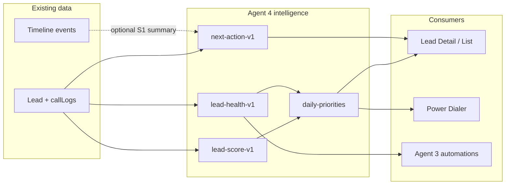

# Wave 6 Phase 1 — Agent 4: CRM Intelligence Audit

**Status:** Phase 1 audit complete — documentation only  
**Date:** 2026-07-13  
**App:** `telecaller-app/`  
**Constraint:** No AI implementation, no lead-logic / scoring / Firestore / shared-type changes in this phase.  
**Conflict risk:** Very low — this file only.

---

## Executive verdict

Golden Acres CRM has **manual priority labels**, **follow-up / overdue / idle heuristics**, **phone-based duplicate merge**, and **agent activity scoring** — but **no lead scoring model**, **no booking prediction**, **no lead-health score**, **no AI summaries**, and **no recommendation / next-action engine**.

Wave 6 intelligence should start as a **deterministic, explainable layer** on existing fields (`status`, `priority`, `followUpDate`, `updatedAt`, `callLogs`, pipeline stage), then optionally add LLM surfaces later behind an Architecture Owner–owned AI service interface.

---

## 1. Current-state inventory (what exists today)

### 1.1 Lead scoring — **absent (manual proxy only)**

| Signal | Behavior | Path |
| --- | --- | --- |
| `Lead.priority` | Optional string; UI treats as `hot` / `warm` / `cold`; default `"warm"` | `telecaller-app/src/features/leads/types/index.ts` |
| Agent sets priority | Call log form “Priority Classification” select | `telecaller-app/src/features/leads/components/CallLoggingForm.tsx` |
| Persisted on call save | Written with status / follow-up from Lead Detail | `telecaller-app/src/features/leads/pages/LeadDetailsPage.tsx` |
| Display | Hot / Cold badges on list rows & admin table | `telecaller-app/src/features/leads/components/LeadsTableRow.tsx`, `telecaller-app/src/features/admin/components/AdminLeadsTab.tsx` |
| Filter | Dashboard “hot” quick filter; list advanced `priority` filter | `telecaller-app/src/features/dashboard/hooks/useDashboardLeads.ts`, `telecaller-app/src/features/leads/hooks/useLeadsFiltering.ts` |
| Ingestion default | Webhook / bulk create sets `priority: 'warm'` | `telecaller-app/functions/index.js` |

**Finding:** There is **no computed lead score** (0–100, rank, ML, or rules engine). “Hot” is a human label, not a model output. Quality of the queue depends entirely on agent discipline.

### 1.2 Agent scoring — **present (do not confuse with lead scoring)**

| Model | Formula / rule | Path |
| --- | --- | --- |
| Leaderboard composite | `calls×10 + whatsapp×15 + bookings×100` | `telecaller-app/src/features/dashboard/components/LeaderboardWidget.tsx` |
| Badges / streak / call counts | Threshold badges (50/200 calls, visits, bookings) | `telecaller-app/src/features/dashboard/utils/agentStats.ts` |
| Call quality stars | Manual 1–5 audit rating + coaching note | `telecaller-app/src/features/admin/components/CallAuditRatingModal.tsx`, `CallQualityTab.tsx` |
| Admin conversion KPI | `booked / total leads × 100` (portfolio rate, not per-lead predict) | `telecaller-app/src/features/admin/pages/AdminDashboard.tsx` |

**Finding:** Existing “scoring” is **agent productivity / gamification**, not lead intelligence. Wave 1 audit already locked not changing leaderboard formula without separate scope (`directives/wave1-agent-dashboard-ui-audit.md`).

### 1.3 Booking prediction — **absent**

- No probability field on `Lead`.
- No stage-transition rates, source-lift models, or time-to-book estimates.
- Closest artifact: static **conversion rate** on Admin Dashboard (`bookedLeadsCount / totalLeadsCount`).
- Pipeline is a **manual stage tracker**, not a predictive funnel: `LEAD_PIPELINE_STAGES` in `telecaller-app/src/features/leads/components/LeadPipelineTracker.tsx`.

### 1.4 Lead health — **partial heuristics only**

| Heuristic | Rule | Path |
| --- | --- | --- |
| Idle badge | `updatedAt` older than **3 days** AND status ∉ `{booked, not-interested}` | `telecaller-app/src/features/leads/hooks/useLeadsFiltering.ts` → `isLeadIdle` |
| Overdue | `followUpDate < today` AND status ∉ `{booked, not-interested}` | Same file; also `useDashboardLeads.ts`, `LeadsTableRow.tsx` |
| Hot count | `priority === "hot"` | `useDashboardLeads.ts` |
| Re-engaged | Call note contains `"[Re-Engaged]"` | `useDashboardLeads.ts`, `QuickAccessStatusTabs.tsx` |

**Finding:** Health is three disconnected flags (idle / overdue / hot). No composite health band (Healthy / At risk / Critical), no days-since-last-touch derived from `callLogs`, no SLA clock.

### 1.5 Duplicates — **present (phone-centric)**

| Layer | Behavior | Path |
| --- | --- | --- |
| Client add | Exact `normalizePhone` match → merge notes into existing, return `isDuplicate` | `telecaller-app/src/features/leads/hooks/useLeadsStore.ts` (`addLead`, `bulkAddLeads`) |
| Webhook / Cloud Functions | `duplicateHandlingRule`: `merge` \| `skip` \| `create` | `telecaller-app/functions/index.js` |
| Admin merge UI | Scan all leads by digit-normalized phone; field-picker merge + delete source | `telecaller-app/src/features/admin/components/settings/MergeSettingsTab.tsx` |
| Settings | Integration duplicate rule exposed in admin | `telecaller-app/src/features/admin/hooks/useIntegrationsSettings.ts` |
| UX messaging | Toast / copy: “Duplicate detected — merged…” | `LeadSubmissionForm.tsx`, `Dashboard.tsx`, `BulkLeadImportModal.tsx` |

**Gaps:** No fuzzy name match, no email match, no graph of “possible duplicates” on Lead Detail, no confidence score, no automatic suggestion of merge target when viewing a lead.

### 1.6 AI summaries — **absent**

| Surfaced as “smart” | Actual mechanism | Path |
| --- | --- | --- |
| Smart Call Scripts | Status-string template switch (not LLM) | `telecaller-app/src/features/leads/components/SmartCallScript.tsx` |
| WhatsApp Assistant | Static templates with `{name, project, …}` | `WhatsAppAssistant.tsx`, `telecaller-app/src/shared/constants/whatsappTemplates.ts` |
| Call Conversation Summary | Required **manual** textarea | `CallLoggingForm.tsx` |
| Coaching tip | Admin/store tip or hardcoded fallback quote | `CoachingTipWidget.tsx`, `useCoachingTipStore` |
| Proximity “Insights” | Project proximity / competitor static or project data | `LeadProximityInsights.tsx` |
| Timeline `summary` | Event summary field search — not AI-generated | `LeadInteractionHistory.tsx` |

**Finding:** Repo search found **no** Gemini / OpenAI / Vertex / `generateContent` lead-intelligence integration. Login copy (“Manage plots and leads with intelligence”) is marketing, not a feature.

### 1.7 Next actions — **implicit only**

Today’s “what should I do next?” is reconstructed by the agent from:

1. `followUpDate` (primary list column + overdue/today filters)  
2. Pipeline `status`  
3. Manual `priority`  
4. Power Dialer queue = **current filtered list order** (not ranked) — `LeadsWorkspace.tsx` (`powerDialerQueue` from `myLeads.map(id)`)  
5. Manual Tasks widget (personal checklist, not lead-derived) — `TasksWidget.tsx`

There is **no** `nextAction` / `recommendedChannel` / `recommendedAt` field and no rules that emit “Call now”, “Send WA follow-up”, “Schedule site visit”, etc.

### 1.8 Stale leads — **partial (idle + overdue)**

- **Idle:** 3-day `updatedAt` rule (`isLeadIdle`) — badge only; not a dedicated queue mode.  
- **Overdue follow-up:** first-class queue (`queueMode === "overdue"`, dashboard tab).  
- **No** “no contact in N days from last call log”, **no** auto-reassign, **no** auto-archive of stale leads.

Note: messaging `webhookHealth: "stale"` is **integration health**, not lead staleness (`telecaller-app/src/features/messaging/types.ts`).

### 1.9 Daily priorities — **filter counts, not a priority engine**

| Surface | What it shows | Path |
| --- | --- | --- |
| Dashboard stats | `followupsToday`, `overdueCount`, `hotCount`, status buckets | `useDashboardLeads.ts` |
| Quick access tabs | Today / Hot / Overdue / Not attempted / Re-engaged | `QuickAccessStatusTabs.tsx` |
| Follow-up alerts | Leads with `followUpDate === today` (managerial sees all) | `Dashboard.tsx` → `followUpAlertLeads` |
| Calls / Bookings today widgets | Activity KPIs | `CallsTodayWidget.tsx`, `BookingsTodayWidget.tsx` |

**Finding:** Daily work is **filter-driven**, not **ranked**. An agent with 40 “today” follow-ups gets no ordering by likelihood to book or by SLA urgency beyond date equality / overdue boolean.

### 1.10 Lead Detail intelligence surfaces (Wave 6 context)

`LeadDetailsPage.tsx` columns today:

| Column | Components | Intelligence role |
| --- | --- | --- |
| 1 | Profile, WA panel, Plot locator, **SmartCallScript** | Templates / tools |
| 2 | History / Loan / Site visit / **Proximity Insights** | History + static insights |
| 3 | Dialer, Call log (priority+FU), Discount, WA assistant | Manual capture |

**Gap:** No score strip, health band, next-action card, duplicate warning, or AI brief on the page that Wave 6 will modernize.

---

## 2. Intelligence specification (target product contract)

### 2.1 Goals

1. Tell an agent **which leads to work first** today.  
2. Tell them **why** (explainable factors).  
3. Suggest **one next action** + channel.  
4. Surface **risk** (stale / overdue / duplicate) before bad outcomes.  
5. Keep Phase 2+ implementation **deterministic-first**; LLMs optional and behind Architecture Owner AI interfaces.

### 2.2 Non-goals (Phase 1 / early Wave 6)

- Replacing manual `priority` overnight (keep as override).  
- Changing leaderboard agent score formula without separate product approval.  
- Training opaque black-box models as the only ranking signal.  
- Rewriting Timeline Engine, Firestore schema, or shared types without Agent 0.

### 2.3 Capability map

| Capability | Definition | Inputs (existing) | Output | Consumer surfaces |
| --- | --- | --- | --- | --- |
| **Lead Score** | 0–100 intent / urgency rank | status, priority, followUpDate, updatedAt, callLogs length/recency, siteVisit, source | `score`, `scoreBand`, `factors[]` | List sort, Lead Detail header, Power Dialer order |
| **Booking Probability** | P(booked \| current state) estimate | stage, days-in-stage, site visit, call connect rate, source | `pBook` 0–1 + confidence | Lead Detail, Admin analytics later |
| **Lead Health** | Healthy / Watch / Critical | idle, overdue, RNR streak, missing FU date | `health`, `healthReasons[]` | Badge + daily queue |
| **Duplicate Risk** | Phone (+ later email/name) | phone, email, name | `dupRisk`, `candidateIds[]` | Lead Detail banner, Merge Settings |
| **AI Summary** | Short brief of history | timeline + callLogs notes | `summaryText`, `generatedAt` | Lead Detail (optional LLM) |
| **Next Action** | Single recommended step | score factors + status + FU | `action`, `channel`, `dueHint` | Lead Detail + Daily Priorities |
| **Daily Priorities** | Ranked work queue for today | score + health + ownership | ordered `leadId[]` | Dashboard / Leads command surface |
| **Stale detection** | Unified stale definition | last activity timestamp | `isStale`, `staleDays` | Filters + automation (Agent 3) |

### 2.4 Data contract (proposed — do not implement yet)

Conceptual fields (Architecture Owner decides persistence vs computed-on-read):

```ts
// PROPOSAL ONLY — not in codebase
interface LeadIntelligence {
  score: number;                 // 0–100
  scoreBand: "hot" | "warm" | "cold"; // may diverge from manual priority
  scoreFactors: { id: string; label: string; delta: number }[];
  bookingProbability: number;    // 0–1
  health: "healthy" | "watch" | "critical";
  healthReasons: string[];
  staleDays: number;
  duplicateRisk: "none" | "possible" | "confirmed";
  duplicateCandidateIds?: string[];
  nextAction: {
    type: "call" | "whatsapp" | "schedule_visit" | "log_outcome" | "request_discount" | "close_lost" | "merge_review";
    reason: string;
    channel?: "phone" | "whatsapp";
  };
  summary?: { text: string; source: "rules" | "llm"; updatedAt: string };
  computedAt: string;
  version: string;               // formula version e.g. "lead-score-v1"
}
```

**Override policy:** Manual `Lead.priority` remains writable. Display should show both **System band** and **Agent priority** when they disagree.

### 2.5 Explainability requirement

Every score / next action must expose 2–5 human factors (e.g. “Overdue follow-up +2 days”, “Site visit confirmed”, “No touch in 5 days”). Opaque scores are rejected for telecaller UX (same trust issue Wave 1 noted for agent leaderboard).

### 2.6 Architecture ownership

| Concern | Owner |
| --- | --- |
| Shared `LeadIntelligence` type / AI service interface | Architecture Owner (Agent 0) |
| Deterministic scorer pure functions | Agent 4 implementation track (post-auth) |
| Timeline event feeds for summaries | Agent 2 |
| SLA / reminder automations consuming health | Agent 3 |
| UI placement on Lead Detail / list | Presentation track under Wave 6 UI rules + DLS v1.4 |
| Firestore write path for cached scores | Architecture Owner |

---

## 3. Scoring proposal (`lead-score-v1`)

### 3.1 Design principles

1. **Deterministic, pure function** of lead snapshot (+ optional “today” date).  
2. **Bounded** 0–100; clamp after sum.  
3. **Versioned** so historical caches can be invalidated.  
4. **Compatible** with existing hot/warm/cold mental model via bands.  
5. **No LLM** in v1.

### 3.2 Base + deltas (proposed)

Start at **40** (neutral warm).

| Factor ID | Condition | Delta | Rationale |
| --- | --- | --- | --- |
| `manual_hot` | `priority === "hot"` | +20 | Respect agent judgment |
| `manual_cold` | `priority === "cold"` | −15 | Deprioritize |
| `stage_interested` | status `interested` | +12 | Mid-funnel intent |
| `stage_site_visit` | `site-visit-confirmed` / `completed` | +18 | Strong booking precursor |
| `stage_reserved` | `reserved` | +22 | Near-close |
| `stage_booked` | `booked` | score fixed **100** or exclude from dial queues | Terminal win |
| `stage_not_interested` | `not-interested` | score fixed **0** or exclude | Terminal loss |
| `stage_new_raw` | `new` / `raw` / `not-attempted` | +5 | Fresh inventory |
| `stage_rnr` | `rnr` | −5 | Harder contact |
| `followup_today` | `followUpDate === today` | +15 | Daily commitment |
| `followup_overdue` | FU &lt; today (active) | +10 + `min(10, overdueDays)` | SLA urgency |
| `followup_missing` | no FU and status not terminal | −8 | Unmanaged |
| `idle_3d` | `isLeadIdle`-equivalent | −12 | Stale risk |
| `idle_7d` | no `updatedAt` activity ≥ 7d | −20 | Severe stale |
| `recent_connect` | call log disposition Connected in last 48h | +8 | Momentum |
| `has_site_visit_obj` | `siteVisit` present | +6 | Scheduled commitment |
| `source_paid` | notes/source Google/Meta ads | +4 | Paid acquisition bias (tunable) |
| `duplicate_suspected` | phone match group size &gt; 1 | −5 + flag | Data quality |

**Bands:**

| Score | Band |
| --- | --- |
| ≥ 70 | hot |
| 40–69 | warm |
| &lt; 40 | cold |

### 3.3 Booking probability (`pBook-v1`) — rules sketch (not ML)

Use **stage priors** calibrated later from Admin historical conversion; initial priors (illustrative only):

| Stage | Prior P(book) |
| --- | --- |
| new / raw / not-attempted | 0.05 |
| contacted / rnr | 0.08 |
| interested | 0.18 |
| site-visit-* | 0.35 |
| reserved | 0.65 |
| booked | 1.0 |
| not-interested | 0.0 |

Adjustments: `+0.05` if FU today; `−0.05` if idle ≥ 7d; `+0.08` if site visit object exists; clamp `[0, 1]`.

**Calibration path:** Offline job or Admin report comparing priors to realized bookings by stage/source — Agent 5 / analytics, not Phase 1.

### 3.4 Lead health bands

| Health | Rule (any match → escalate) |
| --- | --- |
| **Critical** | Overdue ≥ 2 days OR idle ≥ 7 days OR (hot + overdue) |
| **Watch** | Overdue 1 day OR idle 3–6 days OR missing FU on non-terminal |
| **Healthy** | Else |

Reuse logic already in `isLeadIdle` / overdue filters; unify naming to **staleDays** = days since `max(updatedAt, last callLog.date)`.

### 3.5 Relationship to existing agent score

Keep **LeaderboardWidget** formula unchanged. Document clearly in UI tooltips:

- **Agent score** = productivity  
- **Lead score** = who to call  

Do not mix into one number.

### 3.6 Implementation sketch (post-authorization)

```
execution/ or telecaller-app/src/features/leads/intelligence/
  leadScore.ts          // pure leadScoreV1(lead, today) 
  leadHealth.ts
  bookingProbability.ts
  nextAction.ts
  dailyPriorities.ts
```

Prefer **computed-on-read** for v1 (no Firestore schema change). Cache later if Agent 5 finds list-perf issues.

---

## 4. Recommendation engine proposal

### 4.1 Purpose

Given a lead (+ optional agent context), emit **exactly one** primary next action and an optional secondary tip. Power Dialer and Daily Priorities consume the same ranked list.

### 4.2 Decision table (`next-action-v1`)

Evaluate **top-down**; first match wins:

| Priority | Condition | Action | Channel | Reason template |
| --- | --- | --- | --- | --- |
| 1 | `duplicateRisk === confirmed/possible` and agent is managerial | `merge_review` | — | Duplicate phone group |
| 2 | status `site-visit-confirmed` and visit date ≤ today | `call` | phone | Confirm / host site visit |
| 3 | status `interested` and no `siteVisit` | `schedule_visit` | phone | Push site visit |
| 4 | `followUpDate === today` or overdue | `call` | phone | Follow-up due |
| 5 | disposition last = RNR / unanswered ×≥2 | `whatsapp` | whatsapp | Break RNR with WA |
| 6 | status `new`/`raw`/`not-attempted` | `call` | phone | First contact |
| 7 | idle ≥ 3d and had prior connect | `whatsapp` | whatsapp | Re-engage |
| 8 | status `reserved` | `call` | phone | Close documentation / payment |
| 9 | health Critical and not terminal | `call` | phone | Rescue at-risk lead |
| 10 | else | `log_outcome` | phone | Refresh status & FU |

Optional secondary: map to existing **SmartCallScript** status template or **WhatsApp** template id (`intro` / `followup` / `visit`) — still rule-based, not LLM.

### 4.3 Daily Priorities queue

**Input:** leads assigned to agent (or all if managerial).  
**Exclude:** `booked`, `not-interested` (unless filter explicitly includes).  
**Sort key (stable):**

1. Health Critical before Watch before Healthy  
2. Descending `leadScore`  
3. Ascending overdue days (more overdue first)  
4. Ascending `followUpDate` (empty last)  
5. Descending `updatedAt`

**Output:** top N (e.g. 15) for dashboard “Today’s priorities”; full order for Power Dialer when enabled.

**Migration of Power Dialer:** replace `myLeads.map(id)` FIFO with `dailyPriorities(myLeads)` — product decision; do not ship without auth.

### 4.4 AI Summary (phase later — optional)

| Tier | Mechanism | When |
| --- | --- | --- |
| **S0 Rules brief** | Concat last 3 call notes + status + FU + health reasons (truncate 400 chars) | Ship with score v1 — no AI cost |
| **S1 LLM brief** | Architecture Owner AI interface; input = timeline events + notes; output = 3 bullets | After Agent 2 timeline normalization |
| **S2 Coaching** | Suggest objection handling from notes | After S1 quality validated |

**Hard rule:** LLM must never silently overwrite `status`, `priority`, or `followUpDate`. Suggestions only.

### 4.5 Duplicate intelligence upgrade

Keep phone merge as source of truth; add:

1. **On Lead Detail:** if other leads share normalized phone → banner “N possible duplicates” → deep link Merge Settings / merge assistant.  
2. **Confidence:** `confirmed` = exact phone; `possible` = same last-10 digits with different country-code formatting edge cases; later email/name soft match.  
3. **Score penalty** as in §3.2 so duplicates don’t inflate dial queues twice.

### 4.6 Integration with other Wave 6 agents



---

## 5. Gap matrix (priority for Phase 2 planning)

| # | Gap | Impact | Effort | Depends on |
| --- | --- | --- | --- | --- |
| P0 | No lead score / ranked daily queue | Agents waste dials on cold/stale | M | Pure functions + UI sort |
| P0 | Next action not explicit on Lead Detail | Inconsistent coaching | S | Rules table + Detail strip |
| P1 | Idle vs overdue vs stale fragmented | Missed SLA | S | Unify health model |
| P1 | Duplicate not visible on Lead Detail | Double work / bad history | S | Reuse Merge phone scan |
| P1 | Power Dialer ignores urgency | Queue ≠ priorities | S | Hook to dailyPriorities |
| P2 | No booking probability | Managers lack forecast | M | Priors + later calibration |
| P2 | No AI / rules summary | Long history hard to scan | M | S0 rules; S1 needs Agent 0 + Agent 2 |
| P3 | Manual priority vs system band conflict UX | Confusion | S | Dual-label display |
| P3 | Source-based score tuning | Paid vs organic lift | M | Analytics |

---

## 6. Keep / improve / introduce

### Keep

- Manual `priority` hot/warm/cold as **override**.  
- Overdue / today / hot **filters** (`useDashboardLeads`, `useLeadsFiltering`).  
- Phone duplicate merge pipeline (`useLeadsStore`, Functions, `MergeSettingsTab`).  
- Template assistants (`SmartCallScript`, WhatsApp templates) as recommendation **payloads**.  
- Agent leaderboard score as **separate** productivity metric.  
- `isLeadIdle` 3-day idea (fold into health, don’t delete).

### Improve

- Unify idle + overdue into **Lead Health**.  
- Rank Power Dialer and daily work by score/health.  
- Surface duplicate risk on Lead Detail.  
- Make call-log “summary” feed a rules brief (S0).  
- Document factor tooltips (avoid opaque scores).

### Introduce (post Phase 1 authorization)

- `lead-score-v1`, `pBook-v1`, `next-action-v1`, `daily-priorities`.  
- Lead Detail intelligence strip (presentation under Wave 6 UI governance).  
- Optional LLM summary via Architecture Owner AI interface only.

---

## 7. Risks & constraints

| Risk | Mitigation |
| --- | --- |
| Agents fight system score | Show factors; keep manual priority override |
| Score thrash on every keystroke | Compute on read; debounce UI; version formula |
| Firestore write amplification | Prefer computed-on-read until Agent 5 says otherwise |
| Duplicate false positives | Phone-confirmed only for auto-penalty; soft matches advisory |
| LLM cost / hallucination | Ship S0 first; S1 behind flag; never auto-write CRM fields |
| Conflict with Agent 3 automations | Automations consume health/nextAction; don’t fork rules |
| Shared types locked | Agent 0 owns new interfaces |

---

## 8. Acceptance criteria for a future Phase 2 “Intelligence v1”

Documentation-ready checklist (not executed now):

- [ ] Pure `leadScoreV1` unit tests for terminal statuses, overdue, idle, manual hot.  
- [ ] Daily Priorities order stable and explainable.  
- [ ] Lead Detail shows score band + factors + next action (presentation-only wiring OK).  
- [ ] Manual priority still editable via Call Logging Form.  
- [ ] Leaderboard agent score unchanged.  
- [ ] No LLM required for v1.  
- [ ] Duplicate banner when phone group size &gt; 1.  
- [ ] Power Dialer optional use of ranked queue (feature flag).

---

## 9. Source index (paths cited)

| Area | Paths |
| --- | --- |
| Lead model | `telecaller-app/src/features/leads/types/index.ts` |
| Lead Detail shell | `telecaller-app/src/features/leads/pages/LeadDetailsPage.tsx` |
| Manual priority / FU | `CallLoggingForm.tsx`, `CallLogModal.tsx`, `MapCallLogModal.tsx` |
| Idle / filters | `useLeadsFiltering.ts`, `useDashboardLeads.ts`, `LeadsTableRow.tsx` |
| Daily / dashboard | `Dashboard.tsx`, `QuickAccessStatusTabs.tsx`, `WidgetGrid.tsx` |
| Agent score | `LeaderboardWidget.tsx`, `agentStats.ts` |
| Templates / “smart” | `SmartCallScript.tsx`, `WhatsAppAssistant.tsx`, `whatsappTemplates.ts` |
| Insights (non-AI) | `LeadProximityInsights.tsx`, `LeadAcquisitionAnalytics.tsx` |
| Pipeline | `LeadPipelineTracker.tsx` |
| Duplicates | `useLeadsStore.ts`, `functions/index.js`, `MergeSettingsTab.tsx` |
| History | `LeadInteractionHistory.tsx` |
| Dialer queue | `LeadsWorkspace.tsx` |
| Call QA | `CallAuditRatingModal.tsx` |
| Conversion KPI | `AdminDashboard.tsx` |
| Prior wave note on scoring | `directives/wave1-agent-dashboard-ui-audit.md` |

---

## 10. Handoff

| To | Ask |
| --- | --- |
| **Agent 6 (consolidate)** | Fold this spec into Wave 6 master plan; gate Phase 2 on user auth |
| **Agent 0** | Approve `LeadIntelligence` shape + AI service interface (if S1 wanted) |
| **Agent 2** | Ensure timeline events sufficient for S1 summary inputs |
| **Agent 3** | Consume `health` / `nextAction` for reminders — don’t redefine stale |
| **Agent 5** | Advise computed-on-read vs cached score for list scale |
| **UI track** | Place intelligence strip on Lead Detail without inventing new overlay systems (DLS v1.4) |

**Phase 1 complete for Agent 4.** No application code was modified.
