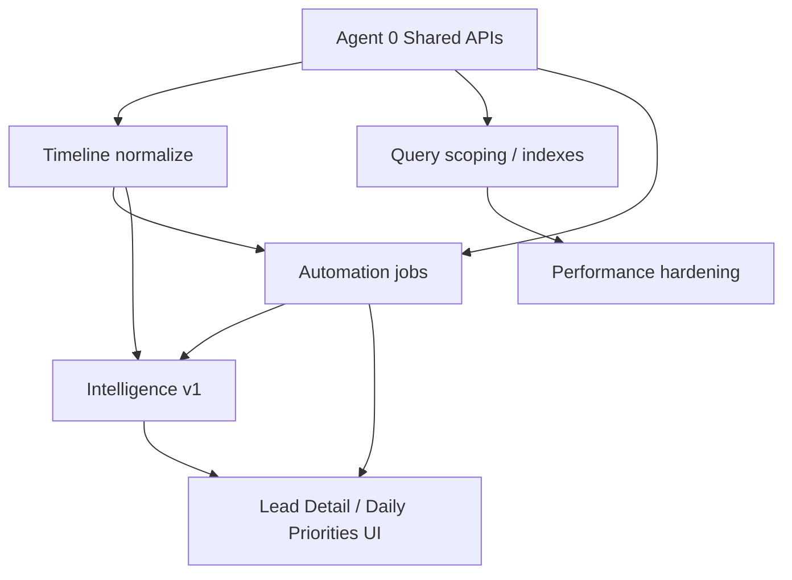

# Wave 6 Phase 1 — Executive Report
## CRM Intelligence & Workflow Automation (Audit Consolidation)

**Status:** Phase 1 complete — **audit & planning only**  
**Date:** 2026-07-13  
**Consolidator:** Agent 6 (Documentation)  
**Sources:** Agents 1–5 audits + Agent 0 architecture review  
**DLS:** remains **v1.4** (no bump)  
**App:** `telecaller-app/` — **no application code changed in Phase 1**

---

## Executive Summary

Wave 6 Phase 1 audited the CRM as a **business-capability** system (workflow, timeline, automation, intelligence, performance)—not another UI redesign. Waves 1–5 closed the Design Language surface (DLS **v1.4**). Wave 6 asks: *how should the CRM think, remember, remind, and scale?*

**Verdict across five audits:**

| Domain | Maturity | Headline |
| --- | --- | --- |
| **Workflow (A1)** | Manual / UI-driven | Fragmented status taxonomy; site-visit & booking semantics broken; `logCall` abused as event bus |
| **Timeline (A2)** | Partial canonical stream | `timelineEvents` exists; most ops still go through heuristic `callLogs`; missing/noisy events |
| **Automation (A3)** | Thin crons + badges | No rules engine; same-day FU FCM exists; overdue/SLA/visit/stuck are display-only or gaps |
| **Intelligence (A4)** | Absent (heuristics only) | Manual priority; no lead score, health band, next-action, or ranked daily queue |
| **Performance (A5)** | Fine for small/medium N | Unbounded full-collection listeners (esp. `leads`) are the primary scale risk |

The CRM works as a **human-operated tool**. Highest leverage is not a greenfield AI/BPM rewrite—it is **Agent 0 shared contracts** (status transitions, typed timeline publish, notification helper, query scoping), then **normalization**, then **extend existing crons**, then **deterministic intelligence**, with performance hardening gated alongside data-path changes.

**Phase 1 success criteria (from `wave6-execution-plan.md`) — met:**

- [x] CRM workflow audit  
- [x] Timeline architecture documented  
- [x] Automation opportunities identified  
- [x] Intelligence roadmap completed  
- [x] Performance audit completed  
- [x] Risks documented  
- [x] Dependencies mapped  
- [ ] Executive implementation plan **approved by user** ← gate for Phase 2  

---

## Master Recommendations (ranked P0 / P1 / P2)

Cross-audit priorities. **P0 = must land before or as first Phase 2 work.** Owners are post-authorization tracks under Architecture Owner lock rules.

### P0 — Foundation (do first)

| # | Recommendation | Source | Owner | Why first |
| --- | --- | --- | --- | --- |
| **P0-1** | **Shared APIs freeze:** typed timeline publishers, activity-intent / status-transition helper, notification pipeline helper, query-scoping patterns | A0 / A1 / A2 / A3 / A5 | **Agent 0** | Unblocks all feature work; prevents fork |
| **P0-2** | **Canonical status enum + single write path**; stop overloading `logCall` for non-calls; **stop overwriting `Lead.notes`** | A1 | Agent 0 + leads | Fixes wrong KPIs and lost notes |
| **P0-3** | **Timeline publisher discipline:** explicit event types (no note heuristics); follow-up emit only on date **diff**; retire WA deep-link → `callLogs` writes | A2 | Agent 0 + publishers | Makes Activity stream trustworthy |
| **P0-4** | **Site visit schedule → `site-visit-confirmed`** (+ completed/no-show path planned) | A1 | Feature + shared status | Highest workflow defect; blocks visit automations |
| **P0-5** | **Scope lead / notifications / audit / attendance listeners** (role-scoped leads; `userId` notifs; audit write/list split; date-scoped attendance) | A5 | Agent 0 + data layer | Scale + cost before adding more jobs/UI |
| **P0-6** | **Overdue follow-up + same-day cron hardening** (IST date, overdue window, `follow_up_reminder_days`, FCM + in-app) | A3 | Agent 0 + cron | Highest-ROI automation; data already present |
| **P0-7** | **First-touch SLA notify** (serverize `checkSlaBreach`; FCM + in-app; optional timeline) | A3 | Agent 0 + cron | Badge-only today; closes first-touch gap |

> **Top 5 P0 for Phase 2 kickoff decision:** P0-1 → P0-2 → P0-3 → P0-4 → P0-5 (then P0-6/P0-7 as first automation slice).

### P1 — High value after foundation

| # | Recommendation | Source |
| --- | --- | --- |
| **P1-1** | Disposition → suggested status mapping; align CallLog / Map / Detail forms | A1 |
| **P1-2** | Booking action: atomic plot lock when `plotId` present (unify map + detail) | A1 |
| **P1-3** | Typed timeline: `site_visit_*`, `discount_*`, `lead_merged`; bulk/ingest `lead_created` | A2 |
| **P1-4** | Missed-call structured event + notify/task; retire note heuristics | A3 |
| **P1-5** | Site-visit day-before / morning-of reminder cron | A3 |
| **P1-6** | Stuck-lead escalation notify (consume unified health — do not fork thresholds) | A3 / A4 |
| **P1-7** | Deterministic `lead-score-v1` + next-action strip + Daily Priorities / optional ranked Power Dialer | A4 |
| **P1-8** | Unify idle/overdue into Lead Health bands; duplicate banner on Lead Detail | A4 |
| **P1-9** | Timeline “load older”; collapse legacy `callLogs` when timeline present; Evolution phone equality query | A5 / A2 |

### P2 — Later / polish

| # | Recommendation | Source |
| --- | --- | --- |
| **P2-1** | Auto task generation (`TaskItem` + `leadId` / `dueAt` / `source`) | A3 |
| **P2-2** | Reassign-on-idle / SLA policy (product sign-off) | A3 |
| **P2-3** | `pBook-v1` booking probability + calibration | A4 |
| **P2-4** | Rules brief (S0) then optional LLM summary (S1) behind Agent 0 AI interface | A4 |
| **P2-5** | Bundle analyzer + `manualChunks`; lazy modal registry; metrics aggregation docs | A5 |
| **P2-6** | Lost-reason + smarter reopen; WA inbox as system of record | A1 |
| **P2-7** | Normalize `followUpOn` → `followUpDate` write path | A1 |
| **P2-8** | Long-term: migrate bodies off embedded `callLogs` (no bulk backfill in V1) | A2 / A5 |

**Explicit non-goals unless product expands scope:** full BPM/rules engine, bulk `callLogs` → `timelineEvents` migration, leaderboard formula change, DLS bump, UI redesign wave.

---

## Dependency Graph

```text
Agent 0 — Shared APIs (LOCKED OWNER)
  ├── Timeline publish helpers + event contract
  ├── Activity intent / status transition API
  ├── Notification helper (FCM + notifications doc)
  ├── Query scoping patterns + indexes
  └── Shared types (status enum, Task/Notif extensions, LeadIntelligence shape)
          │
          ▼
Timeline normalize (Agent 2 track)
  ├── Explicit publishers (no heuristics)
  ├── Follow-up diff-only
  ├── Site visit / discount / merge types
  └── Legacy callLogs containment
          │
          ▼
Automation (Agent 3 track)
  ├── Extend scheduledFollowUpReminders (overdue + config)
  ├── SLA / stuck / visit reminder crons
  └── Consume health — do not redefine thresholds
          │
          ▼
Intelligence (Agent 4 track)
  ├── lead-score-v1 / health / next-action (computed-on-read)
  ├── Daily Priorities + optional dialer rank
  └── Optional S1 LLM only after timeline quality + Agent 0 AI interface
          │
          ▼
Performance (Agent 5 track — parallel where safe)
  ├── Listener scoping (can start with Agent 0 early)
  ├── Cursor pagination / load-older
  └── Bundle / aggregation polish
```



### Cross-audit corrections (for implementers)

- Agent 1 said follow-up has “no push reminders.” **Agent 3 corrects:** same-day FCM exists via `scheduledFollowUpReminders`; gap is **overdue / multi-day / in-app parity / tasks**.
- Do **not** invent a second stale definition—Agent 3 automations must consume Agent 4 health once shipped.
- Prefer **extend** existing crons/`sendFcm` over a greenfield automation engine.

---

## Agent 0 — Architecture Review (light)

Full detail: [`directives/wave6-agent0-architecture-review.md`](wave6-agent0-architecture-review.md)

### Shared APIs needed before feature work

1. **Timeline publish API** — typed helpers wrapping `recordTimelineEvent`; client/server field parity; idempotency guidance.  
2. **Activity intent / status transition API** — canonical status enum, allowed transitions, one write path (timeline event + lead field).  
3. **Query scoping** — role-scoped leads, `notifications` by `userId`, audit list vs write split, attendance date range + composite indexes.  
4. **Notification helper** — single server path: optional FCM + `notifications` doc (+ optional WA later).  
5. **Intelligence / task type shapes** — `LeadIntelligence` (computed-on-read first); `TaskItem` extensions only when auto-tasks authorized.

### What stays locked

Timeline Engine core, shared automation surface, Firestore collections/rules, shared repos/services, notification infra, AI service interfaces, routing, auth, shared types, DLS, architecture docs — **Architecture Owner only**.

### Conflict notes

| Conflict | Resolution |
| --- | --- |
| Feature agents want custom event strings | Reject — use frozen helpers |
| Parallel stale thresholds (3d/5d/24h/FU) | One health contract; automations consume it |
| Full leads listener vs intelligence list sort | Scope queries first or accept computed-on-read on scoped set |
| WA Assistant vs messaging timeline | Messaging is SoT for WA; stop new WA `callLogs` |
| New cron queries without indexes | Agent 0 + Agent 5 indexes before deploy |

---

## Phase Roadmap (Phase 2+ — ordered, gated)

**Gate:** User must explicitly authorize Phase 2 before any implementation.

### Phase 2A — Agent 0 contract + bleeding stop *(gate: Phase 2 auth)*

1. Freeze status enum + transition helper + typed timeline publishers.  
2. Fix `logCall` notes overwrite; follow-up timeline diff-only.  
3. Site visit → `site-visit-confirmed`.  
4. Listener scoping P0 (leads / notifs / audit / attendance) + required indexes.  
5. Notification helper unification (minimal).

**Exit:** Shared APIs documented + smoke-tested; no feature UI required yet.

### Phase 2B — Timeline normalization

1. Explicit types from call / pipeline / site visit / discount paths.  
2. Stop WhatsAppAssistant → `callLogs` WA writes.  
3. Add `site_visit_*` / discount / merge events as contracted.  
4. UI: collapse legacy pane when timeline present; filter by `type`/`source`.

**Exit:** New activity understandable from `timelineEvents` alone for post-cutover leads.

### Phase 2C — Automation slice 1

1. Overdue + same-day FU cron hardening.  
2. First-touch SLA notify.  
3. (Optional same slice) site-visit reminder cron if visit status fixed.

**Exit:** FCM + in-app for overdue FU and SLA; no full BPM engine.

### Phase 2D — Intelligence v1 (deterministic)

1. `lead-score-v1` + health + next-action (pure functions, unit tests).  
2. Lead Detail strip + Daily Priorities; optional ranked Power Dialer behind flag.  
3. Duplicate phone banner on Lead Detail.

**Exit:** Explainable ranking without LLM; manual `priority` retained; leaderboard unchanged.

### Phase 2E — Automation slice 2 + performance polish

1. Missed-call structured + notify; stuck notify consuming health.  
2. Timeline/messages load-older; Evolution phone equality; bundle analyzer.  
3. Task schema / auto-tasks only if product authorizes.

**Exit:** Attention workflows actionable; scale headroom for 1–3k leads.

### Phase 2F+ — Optional / deferred

- `pBook-v1` calibration, LLM S1 summary, reassign policies, callLogs off-document migration, Algolia-class search at 50k+.

---

## Validation Checklist (when implementation starts)

Use at each Phase 2 sub-gate. Do **not** run as Phase 1 work.

### Shared / Agent 0

- [ ] Status enum + transition helper covered by unit tests (illegal transitions rejected).  
- [ ] Timeline client/Functions payloads field-compatible.  
- [ ] Notification helper always writes consistent `type` + optional FCM.  
- [ ] New Firestore queries have matching indexes deployed.  
- [ ] No feature PR modifies locked islands without Agent 0.

### Workflow

- [ ] Site visit schedule sets `site-visit-confirmed`.  
- [ ] `logCall` does not overwrite profile `notes`.  
- [ ] Pipeline/kanban/call forms write explicit statuses (reserved vs booked clarified).

### Timeline

- [ ] Calls/WA/notes/status/assign/FU appear with correct `type` (no note-prefix classification).  
- [ ] Follow-up events only on actual date change.  
- [ ] WhatsAppAssistant (or successor) does not append `[WhatsApp Sent]` to `callLogs`.  
- [ ] Legacy pane remains; **no** bulk backfill required.

### Automation

- [ ] Overdue FU receives notify (FCM + in-app).  
- [ ] Same-day FU still works; IST date edge cases checked.  
- [ ] SLA breach notifies assignee/manager.  
- [ ] Thresholds align with intelligence health (no duplicate magic numbers).

### Intelligence

- [ ] `leadScoreV1` tests: terminal, overdue, idle, manual hot.  
- [ ] Factors visible in UI; manual priority still editable.  
- [ ] Leaderboard formula unchanged.  
- [ ] No LLM required for v1.

### Performance

- [ ] Agents do not subscribe to full `leads` collection.  
- [ ] Notifications scoped by `userId`.  
- [ ] Audit list not mounted on every Dashboard visit.  
- [ ] Dashboard TTI / snapshot size monitored after scoping.

### Regression / governance

- [ ] DLS still v1.4 unless separately authorized.  
- [ ] No Wave 5 overlay regressions (Modal/Dialog/Drawer).  
- [ ] `check-app` / lint / build pass for touched packages.

---

## Risk Assessment

| Risk | Severity | Likelihood | Mitigation |
| --- | --- | --- | --- |
| Feature agents fork timeline/status shapes | High | Med | Agent 0 freeze first; reject raw `type` strings |
| Status migration breaks filters/KPIs | High | Med | Enum + transition tests; dual-read aliases temporarily |
| More crons without query indexes → cost spike | High | Med | Indexes + scoped queries before jobs |
| Intelligence vs automation threshold drift | Med | High | Single health contract |
| Listener scoping breaks admin “see all” | Med | Med | Role-based query matrix; manager paths explicit |
| Agents reject system scores | Med | Med | Factors + manual priority override |
| LLM hallucination / cost | Med | Low (if deferred) | Ship S0 first; S1 flag; never auto-write CRM fields |
| Double-booking plots | Med | Med | Atomic booking when `plotId` present (P1) |
| Merge conflicts on `useLeadsStore` / `functions/index.js` | Med | High | Serialize Agent 0 merges; feature PRs after APIs |
| Scope creep into BPM / full AI rewrite | High | Med | Stick to extend-crons + deterministic score |

---

## Implementation Order (canonical)

When Phase 2 is authorized, execute in this order (parallel only where noted):

1. **Agent 0** — shared APIs + locks (status, timeline helpers, notif helper, query scoping start).  
2. **Timeline normalize** — publisher discipline + site-visit status write (with A1 semantics).  
3. **Performance P0 scoping** — can run **in parallel with (2)** if Agent 0 owns indexes/listeners.  
4. **Automation P0** — overdue FU + SLA notify.  
5. **Intelligence v1** — score/health/next-action + Daily Priorities.  
6. **Automation P1** — visit reminders, missed-call, stuck (consumes health).  
7. **Intelligence/Perf P1–P2** — dialer rank flag, load-older, bundle analyzer, optional tasks/LLM.

**Merge order reminder (execution plan):** Audit docs already merged conceptually as A1→A5→A0→A6. Implementation merges: **Agent 0 first**, then timeline/workflow fixes, then automation, then intelligence UI, with performance P0 early.

---

## Deliverable Index

| Artifact | Path |
| --- | --- |
| Execution plan | `directives/wave6-execution-plan.md` |
| Agent 1 Workflow | `directives/wave6-agent1-workflow-audit.md` |
| Agent 2 Timeline | `directives/wave6-agent2-timeline-audit.md` |
| Agent 3 Automation | `directives/wave6-agent3-automation-audit.md` |
| Agent 4 Intelligence | `directives/wave6-agent4-intelligence-audit.md` |
| Agent 5 Performance | `directives/wave6-agent5-performance-audit.md` |
| Agent 0 Architecture | `directives/wave6-agent0-architecture-review.md` |
| **This executive report** | `directives/wave6-phase1-executive-report.md` |

---

## STOP

**Phase 1 is complete. No Phase 2 implementation until the user explicitly authorizes it.**

Do **not**:

- Change application / telecaller-app code  
- Modify Firestore schema, rules, or indexes  
- Build automation engine, crons, scoring, or AI  
- Update `ui-registry.md` or bump DLS (stays **v1.4**)  
- Modify architecture docs except living audit/plan files already in scope  

Await: **“Authorize Wave 6 Phase 2”** (or equivalent) before any implementation PR.
