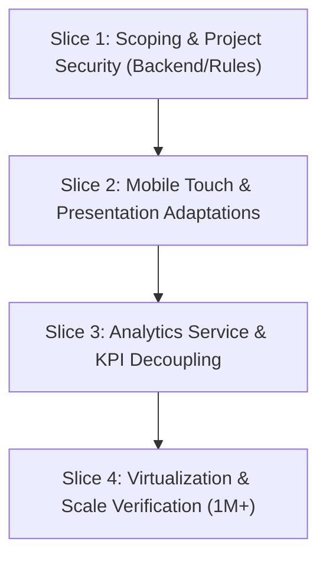

# Wave 8 Phase 1 — Executive Planning Report

**Status:** **PLANNING ONLY**  
**Audience:** Product Owners & Engineering Directors  

---

## 1. CRM Maturity & Strengths (Waves 1-7)

The Golden Acres CRM codebase is highly stable and mature:
- **Consistent Design Language**: Locks UI layout, forms, and dialog states to the canonical DLS v1.4.
- **Robust Mutation Flow**: Follows a strict, human-in-the-loop verification pipeline for all AI proposals.
- **Rules-First Guard**: AI completes advisory operations, while the underlying CRM logic retains authority over states, dates, and assignments.

---

## 2. Technical Debt & Modernization Opportunities

- **Unbounded Queries**: Several dashboard listings lack hard limits or cursor paginations, which will crash performance once lead volume scales to 100k+.
- **Friction on Mobile Devices**: Complex search filters and navigation layouts designed for desktop screens warp or require horizontal scrolling on phone/tablet viewports.
- **Client-Heavy Aggregations**: KPI counts are computed client-side by scanning rosters. This does not scale to enterprise volumes.

---

## 3. Recommended Wave 8 Themes & Ordering

We recommend executing the Wave 8 modernization in the following sequence:

### Effort Estimation
- **Slice 1 (Security & Scoping)**: 3-5 Days (Medium Effort)
- **Slice 2 (Mobile Presentation)**: 4-6 Days (High Effort)
- **Slice 3 (Analytics Service)**: 4-5 Days (Medium-High Effort)
- **Slice 4 (Scale & Virtualization)**: 3-4 Days (Medium Effort)
